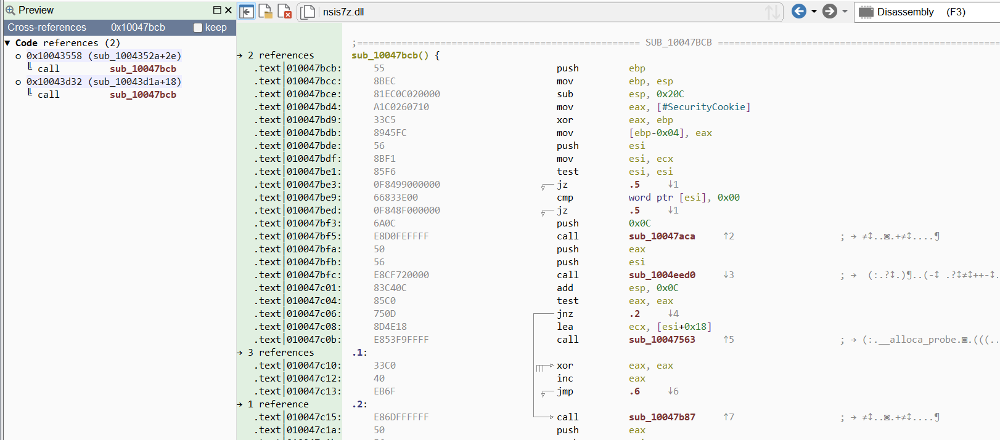
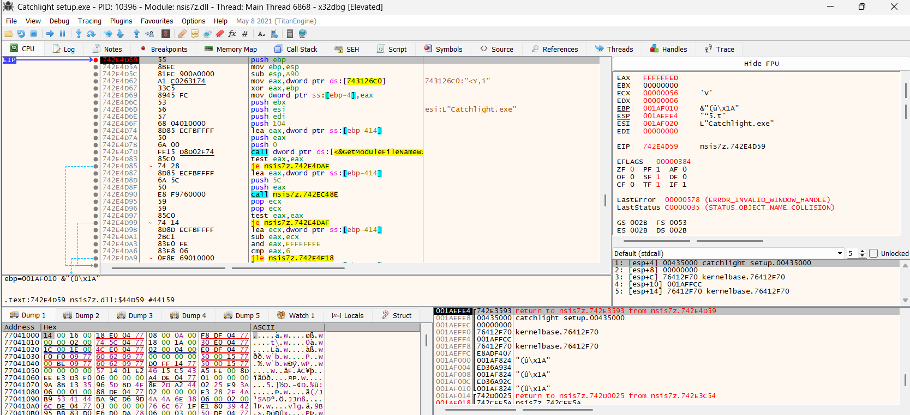
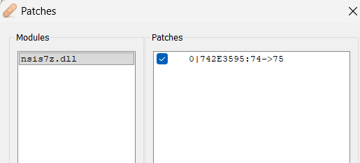
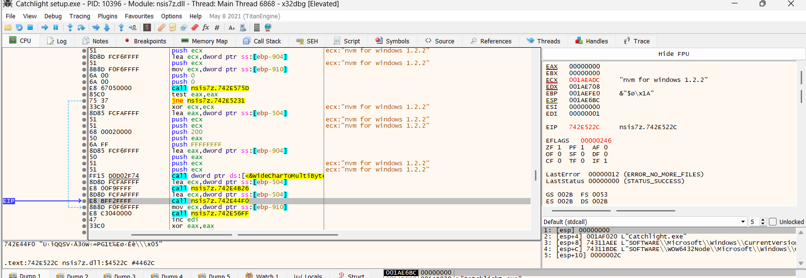
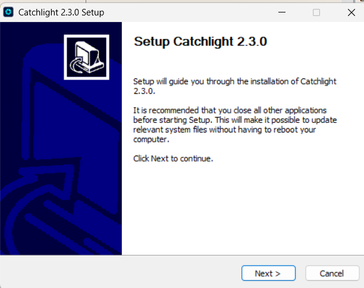
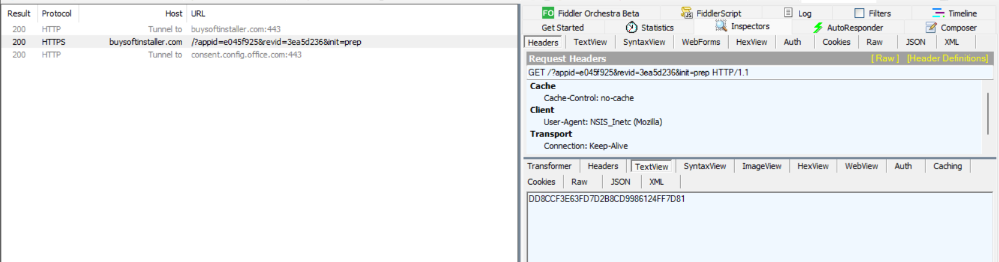
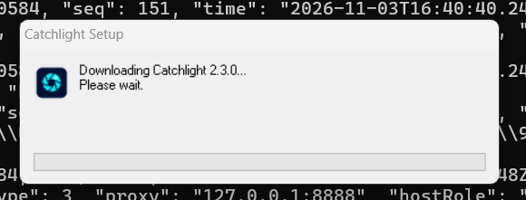

# Dragon’s Gate (Provisional): Catchlight Loader Reconstruction and Related Pre-Installation Activity

**Research updated:** 2026-11-03 (v12: clarified multi-implementation scope and added analyst final thoughts)  
**Working research name:** **Dragon’s Gate** / **Dragon’s Gate Loader** (provisional umbrella term for a suspected installer/distribution cluster, not an established malware-family designation or proof of one shared binary implementation)  
**Status:** Environment gate bypassed; alternate package delivery observed; 256 KiB and 512 KiB synthetic test packages reached the bitwise transform; offline package reconstruction verified; an inert synthetic package satisfied the embedded-size check **and reached the manual x86 PE mapper in a Frida trace**; the mapper rejected the intentionally invalid `MZ` header; authentic second stage **not recovered**  
**Technical scope:** Detailed reverse engineering of Catchlight’s NSIS setup and modified `nsis7z.dll`; CookUp, GooPDF and other suspected related installers are discussed as comparison/context, not analyzed to the same depth in this README  
**Environment:** Isolated Windows FLARE-VM; Malcat, x32dbg, Frida 17.7.3, Fiddler Classic, ProcMon, Process Hacker

> **Executive assessment.** **Dragon’s Gate is a provisional label for potentially related pre-GUI installer activity across multiple implementation technologies, not an assertion that the framework is NSIS-based in every sample.** The Catchlight implementation is NSIS-based. Catchlight 2.3.0 Setup bundles a modified NSIS 7-Zip plugin with obfuscated command handlers, a full AES implementation, explicit screening for `frida-agent.dll`, and additional filesystem/process/module/environment checks. A positive environment-check result routes normal extraction to a decoded `invalid_name` result. Changing the conditional branch at **plugin RVA `0x43595` from `74` (`JZ`) to `75` (`JNZ`)** enabled the installer GUI and a complete installation in instrumented runs. The final installed application appeared benign in the observed execution. **On 2026-11-03, scoped VERIFY overrides exposed the `UPDATE` → `RANDPKG` → `PKG` → `LOADPKG` → `RUN` path. Four genuine-server package requests failed with empty responses; Fiddler substitution of a benign 12-byte synthetic package then produced `PKG → OK|12`, `LOADPKG → OK|0`, `RUN → 0`. Static reversing established the RUN handler includes an in-memory x86 PE mapper and export resolver. A subsequent inert package with a constructed header **reached the mapper dynamically**, where its invalid PE signature was rejected. An authentic second stage was not obtained or executed.**

## 1. Samples and scope

| Artifact | Detail |
|---|---|
| Primary installer | `Catchlight setup.exe`, 32-bit NSIS setup; exact installer hashes not recorded here |
| Embedded plugin | `nsis7z.dll` |
| Plugin SHA-256 | `8fb387439206e314ea1b47d91175d836839f2300d191f217b52d99edd82b9788` **(recalculated from analyzed DLL)** |
| Plugin preferred/static base | `0x10000000` in Malcat |
| Runtime base (x32dbg run) | `0x742A0000` |
| Runtime base (Frida run) | `0x72330000` |
| Application | `Catchlight.exe`, launched successfully by completed installer; its benign appearance does not certify every component as safe |
| Preparation endpoint | `https://buysoftinstaller.com/?appid=e045f925&revid=3ea5d236&init=prep` |

Earlier work encountered an approximately 817 KB setup and an approximately 111.73 MB variant. The larger size may be attributable to padding; establish matching hashes/contents before asserting the variants are identical. Installer certificate identities and installer hashes should be recorded separately from the extracted DLL hash before publication.

## 2. How the gate was identified

### Original failed behavior

Initial Frida hooks of the NSIS exports captured:

```text
ExtractWithCallback("CHECK|2.3.0|0", "0")
  -> https://buysoftinstaller.com/?appid=e045f925&revid=3ea5d236&init=prep
Extract("VERIFY|<32-character server response>") -> "1"
Extract("Catchlight.exe")                   -> "invalid_name"
NSIS script -> Quit
```

A separate uninstrumented ProcMon run loaded `nsis7z.dll`, connected to `104.26.10.88:443`, enumerated filesystem locations including `C:\*` and Desktop, and exited without showing a GUI in approximately 0.78 seconds with process exit status **2**. That run did **not** capture the NSIS plugin's exact return value, so the same `invalid_name` path is plausible but not independently proven in the uninstrumented run.

### Static analysis of the return path

The plugin export `Extract` (`RVA 0x2FF5A`) retrieves the NSIS stack argument with `sub_1003044C`, then dispatches through several handlers. Its fallback includes a call to the environment-screening function `sub_10044D59` (`RVA 0x44D59`). When that function indicates detection, `sub_10043C10` decodes the string `invalid_name` from an XOR-obfuscated UTF-16 sequence at `0x100712F8`; `sub_1003051E` returns the string to the NSIS caller.

The custom command dispatcher `sub_10047BCB` also recognizes the XOR-obfuscated prefix `BUILDLAUNCH|`. This command was *implemented* but **not observed being invoked** in the baseline installation or the later alternate package attempt.



*Figure 1. Original Malcat screenshot of `sub_10047BCB`, a custom plugin command dispatcher. This image illustrates the hidden command handling, **not** the `invalid_name` branch. A separate exact branch screenshot remains to be captured (instructions below).*

> **Missing source screenshot to add:** In Malcat, navigate to `sub_1004352A` near **`0x1004358E`–`0x100435A0`** and include the `call sub_10044D59`, `test eax,eax`, conditional jump and `call sub_10043C10`. For the decoded literal, add a screenshot of `sub_10043C10` / its decoded `invalid_name` result. Do not present the dispatcher screenshot above as if it shows the literal.

### x32dbg validation

A debugger breakpoint at `nsis7z.dll+0x44D59` established that the environment check was actually executed in a GUI-suppressed run. At its return to the dispatcher, **`EAX=1`** was observed, selecting the gated path under the original conditional branch.



*Figure 2. Original x32dbg screenshot stopped at the entry to the environment-screening function `0x742E4D59`, with the return address visible in the stack. The positive `EAX=1` was documented at the function's return, not at this entry screenshot.*

### Minimal in-memory bypass

The branch at **RVA `0x43595`** was patched in memory:

```asm
call sub_10044D59   ; environment check
 test eax, eax
 jz   fallback       ; original 0x74: EAX=0 skips invalid_name
 call sub_10043C10   ; decodes invalid_name when EAX!=0
```

Changing **`0x74` to `0x75`** turns `JZ` into `JNZ`. This **inverts** the outcome rather than unconditionally disabling the check. It causes `EAX=1` to skip the decoded-error path, but reverses the handling of `EAX=0`. The patch is therefore useful as a controlled experiment, not a generic production-safe bypass.

| Context | Module base | Gate RVA | Runtime patch address | Byte change |
|---|---|---|---|---|
| x32dbg | `0x742A0000` | `0x43595` | `0x742E3595` | `74` → `75` |
| Frida | `0x72330000` | `0x43595` | `0x72373595` | `74` → `75` |



*Figure 3. Original x32dbg patch-list screenshot confirming the one-byte conditional-branch change.*

The patched debugger session continued into additional software inventory processing, including an observed `nvm for windows 1.2.2` string:



*Figure 4. Original debugger screenshot of execution continuing beyond the earlier gate. The inventory string is observed data, not evidence that this installed program was singled out for detection.*

The standard Catchlight installer GUI then appeared:



*Figure 5. Original screenshot of the installer GUI after the one-byte in-memory patch.*

## 3. Frida + Fiddler: verified working combination

A later Frida 17.7.3 run reproduced the in-memory `nsis7z.dll+0x43595` patch dynamically and intercepted `wininet!InternetOpenW`, changing WinINet's access type from `1` (direct) to `3` (named proxy) and supplying `127.0.0.1:8888`. This made the plugin's HTTPS request visible to Fiddler despite the NSIS script's `INetC::get /NOPROXY /WEAKSECURITY` options. The hook changes process behavior for analysis; it does **not** prove the `/NOPROXY` option was intended to evade analysis tools.

Frida instrumented output:

```json
{"kind":"gate_patch","moduleBase":"0x72330000","rva":"0x43595","address":"0x72373595","before":"0x74","after":"0x75","status":"ok"}
{"kind":"proxy_override","api":"wininet!InternetOpenW","originalAccessType":1,"newAccessType":3,"proxy":"127.0.0.1:8888"}
```

Fiddler captured the successful HTTPS request with User-Agent **`NSIS_Inetc (Mozilla)`** and a **32-byte hex-text response**:

```http
GET /?appid=e045f925&revid=3ea5d236&init=prep HTTP/1.1
Host: buysoftinstaller.com

HTTP/1.1 200 OK
Content-Type: text/html; charset=UTF-8
Content-Length: 32

DD8CCF3E63FD7D2B8CD9986124FF7D81
```



*Figure 6. Original Fiddler screenshot showing the intercepted preparation request and token response. `consent.config.office.com` appears as a separate tunnel and is **not attributed to Catchlight** by this capture.*

A prior Process Hacker memory search recovered a **different** 32-character response `385BF55A1737AB202A174F1263283A4B`, demonstrating that the server-side value is not necessarily constant. The working GUI with Fiddler token `DD8...` establishes that the server response *alone* cannot explain the previous gated behavior in these runs; the token's full purpose remains unproven.

## 4. Complete successful custom NSIS command trace

The second complete instrumented run occurred on **2026-11-03 12:15:19–12:15:22 UTC**, PID `6396`, and ended with `process-terminated`, `crash: None` (Frida did not report a crash; no exit code was captured).

| # | Relative stage | Export and arguments | NSIS result |
|---|---|---|---|
| 1 | Initial setup | `ExtractWithCallback("CHECK\|2.3.0\|0", "0")` | Preparation URL |
| 2 | After HTTPS response | `Extract("VERIFY\|DD8CCF3E63FD7D2B8CD9986124FF7D81")` | `1` |
| 3 | Initial extraction decision | `Extract("Catchlight.exe")` | `4224` |
| 4 | Follow-up validation | `Extract("VERIFY\|.")` | `1` |
| 5 | Immediately after initialization | `ExtractWithDetails("Catchlight.exe", "")` | `0` |
| 6 | ~3.44 seconds later, following GUI interaction | `ExtractWithDetails("Catchlight.exe", "")` | `0` |

The same first five operations and return values appeared in an earlier run. In the gated tests, `Extract("Catchlight.exe")` returned `invalid_name`; in both patched tests it returned **`4224`**. `4224` is reproducible but its semantic meaning (size, identifier, intermediate value, or status) has **not** been identified. Similarly, `VERIFY|.` returning `1` should not be interpreted as server approval without examining the handler.

In the baseline GUI-installation experiment, the two `ExtractWithDetails` invocations returned `0`; one occurred during initialization and the other after the GUI appeared. The installer completed and launched the expected Catchlight application. No calls to `ExtractWithProgress` were captured, and **no `BUILDLAUNCH|` invocation was captured** in the six exported-command calls. This excludes it from the *observed* successful default installation path, not every possible execution path or other installer variant.

### Condensed command flow

```text
Catchlight setup.exe
 ├─ nsis7z!ExtractWithCallback("CHECK|2.3.0|0", "0")
 │    └─ returns https://buysoftinstaller.com/?...&init=prep
 ├─ INetC HTTPS request  ──> 32-character response
 ├─ nsis7z!Extract("VERIFY|<token>")  -> "1"
 ├─ nsis7z!Extract("Catchlight.exe")
 │    ├─ original detected environment -> "invalid_name" -> exit
 │    └─ gate branch inverted          -> "4224" -> continue
 ├─ nsis7z!Extract("VERIFY|.") -> "1"
 ├─ nsis7z!ExtractWithDetails("Catchlight.exe", "") -> "0"
 ├─ installer GUI / user interaction
 ├─ nsis7z!ExtractWithDetails("Catchlight.exe", "") -> "0"
 └─ installation completes; Catchlight.exe launches
```

## 5. Environment detection details

`sub_10044D59` includes multiple environment-screening mechanisms. Not all have been linked to the positive result in a particular run.

| Category | Observed code behavior | Interpretation limit |
|---|---|---|
| Executable path | Retrieves process/module filename and evaluates path properties | Exact trigger not isolated |
| File and folder names | Uses `FindFirstFileW` / `FindNextFileW` with hashed lookup lists | Entries incompletely identified |
| Loaded modules | Enumerates `TH32CS_SNAPMODULE`, hashes module names | Explicit `frida-agent.dll` entry confirmed |
| Running processes | Enumerates processes, compares names/path identities | No specific trigger verified |
| Additional structured inventory | `sub_10043D44`, two more hashed tables | Underlying data source not fully identified |

### FNV-1a lookup and Frida detection

The helper `sub_10044AEC` performs 32-bit FNV-1a with basis `0x811C9DC5` and prime `0x01000193`, normalizing ASCII uppercase UTF-16 code units to lowercase. Hash constants in at least one table are masked with XOR **`0x934E48CA`**.

For `frida-agent.dll`:

```text
FNV-1a:      0x67833589
XOR mask:    0x934E48CA
Stored DWORD 0xF4CD7D43
```

This is a confirmed hardcoded Frida module-name indicator. It does **not** establish that Frida alone caused every exit: a no-Frida ProcMon run also exited without the GUI.

### SHA-256 process identity checks

`sub_10043E4C` compares process-name and path-derived classifications. One code path hashes a fixed eight-byte salt `60 3D C4 1C 5C 4A 68 26` followed by a normalized string with SHA-256. The code compares digests against internal records and counts classification mismatches; two or more mismatches can trigger a positive result. Candidate tests against a sampled running-process list did not find a match. These tests do not exclude other live values or a different execution context.

## 6. Hidden `BUILDLAUNCH|` and encryption

`sub_10047ACA` decodes an XOR-encoded UTF-16 **`BUILDLAUNCH|`** prefix; `sub_10047BCB` dispatches a string resembling `BUILDLAUNCH|<mode>|<data>` for additional processing.

Within this implementation:

- `sub_1000169B` initializes Rijndael/AES for key sizes 128, 192, or 256 bits, with 16-byte blocks and 10/12/14 rounds.
- `sub_1000180B` performs AES-style rounds; `sub_10001BBF` performs MixColumns; `sub_10002223` implements GF(2^8) multiplication with `0x1B`; `sub_10001A4B` includes AES-256 key-schedule logic.
- A separate decoder yields a **32-character ASCII candidate key** `BFEA4EE8EF934BE7A2B4C64A0BAD1E92`.

The precise cipher mode, IV, input, and downstream purpose remain unverified. There was **no observed `BUILDLAUNCH|` call, decrypted payload, or confirmed payload download** in the baseline installation or in the later v8 package-attempt trace. The existence of cryptographic code alone does not prove malicious use.

## 7. Related samples and VirusTotal Retrohunt (preliminary)

A **365-day VirusTotal Retrohunt** using the following broad string reportedly returned **nine hits**. The researcher reported Catchlight alongside other setups with apparently related signer information:

```yara
rule NSIS_7Zip_Plugin_Discovery
{
    meta:
        description = "Broad discovery of NSIS 7-Zip plugin strings; not malicious-specific"
        target_entity = "file"

    strings:
        $plugin = " NSIS 7-Zip plug-in" wide

    condition:
        $plugin
}
```

This is a **user-reported preliminary finding**: the nine hashes, signer subjects, certificate chains and binary overlap have not yet been independently enumerated in this report. Nine matches are not nine confirmed malicious installers. A separate more specific hunt based on the encoded `BUILDLAUNCH|` prefix was proposed; results are not included here. Preserve both hunts independently; use shared plugin hashes, implementation details, code-signing identity and infrastructure before assigning family/campaign attribution.

## 8. Indicators and detection opportunities

| Indicator | Type | Assessment |
|---|---|---|
| `8fb387439206e314ea1b47d91175d836839f2300d191f217b52d99edd82b9788` | SHA-256 | Verified embedded `nsis7z.dll` |
| `buysoftinstaller.com` | Domain | Observed install preparation endpoint; domain-only detection can overreach |
| `/?appid=e045f925&revid=3ea5d236&init=prep` | URL query | Observed, variant-specific |
| `104.26.10.88:443` | IP/port | Observed in ProcMon; cloud/shared infrastructure possible |
| `CHECK|2.3.0|0`, `VERIFY|...` | Command interface | Executed in traces |
| `BUILDLAUNCH|` | Decoded command | Implemented, not executed in these runs |
| `invalid_name` | Decoded return | Gated path, not itself an IOC |
| `frida-agent.dll` | Anti-analysis detection indicator | A tool module name, **not malware** |
| `0x934E48CA` + FNV-1a constants | Code-level signatures | Stronger in combination with plugin command logic |

**Detection caution:** Generic NSIS plugin strings, AES implementations, Frida names, and Cloudflare-fronted addresses are weak standalone malware indicators. The most useful evidence is a conjunction of this plugin's custom dispatch/obfuscation code, environment gate, and installer execution flow.

## 9. Scoped VERIFY experiments and elevation-following (2026-11-03)

### Instrumentation and breakpoint map

The following are **static DLL VAs** (`0x10000000` image base) and corresponding **RVA offsets**. For x32dbg, use the **actual loaded module base plus RVA**, rather than a hardcoded historical ASLR address. Frida uses `module.base.add(RVA)`.

| Investigation point | Static VA | RVA | Purpose / observed behavior |
|---|---:|---:|---|
| `Extract` export | `0x1002FF5A` | `0x2FF5A` | NSIS plugin command entry |
| `ExtractWithCallback` export | `0x10030033` | `0x30033` | `CHECK` and `UPDATE` commands |
| Fallback command handler | `0x1004352A` | `0x4352A` | Dispatches custom plugin commands |
| Detection gate conditional jump | `0x10043595` | `0x43595` | Original `0x74`; controlled inversion to `0x75` |
| Environment check | `0x10044D59` | `0x44D59` | Returned `EAX=1` in observed detected environments |
| VERIFY precheck | `0x10044435` | `0x44435` | Was `EAX=0`; selectively forced to `EAX=1` |
| VERIFY argument processor | `0x100452ED` | `0x452ED` | Routes to VERIFY result path A or B |
| VERIFY path A | `0x10044C79` | `0x44C79` | Produced string `1` in baseline |
| VERIFY path B | `0x10044CAA` | `0x44CAA` | Produced string `0` when selected |
| `BUILDLAUNCH`-associated handler | `0x10048400` | `0x48400` | Not observed in this experiment |
| `PKG` worker | `0x10047728` | `0x47728` | **Reached four times** in v8; returned `BAD\|0` |
| `PAYLOADMON` candidate | `0x100475E5` | `0x475E5` | Not observed; naming remains provisional |

**How to repeat the debugger work:** Break on module load of `nsis7z.dll`, calculate the runtime address by adding its current base to the chosen RVA, place x32dbg breakpoints on the environment check and fallback dispatch, and inspect `EAX` *after* the return from `sub_10044D59`. Inspect the conditional jump at RVA `0x43595` and patch only in the isolated debugger/Frida process. For the verification checks, break at `0x452ED` and `0x44435`, identify the input (`VERIFY|<token>` versus `VERIFY|.`), and watch the route through `0x44C79` or `0x44CAA` and the NSIS stack return. For package processing, break at `0x47728`, then trace its call to `0x479B4` and read the generated return string.

**Gate #1 — environment detection / extraction suppression.** The fallback path calls `sub_10044D59`. `EAX=1` selected the decoded `invalid_name` result when the unmodified `JZ` (`74`) was used. A one-byte in-memory change at `nsis7z.dll+0x43595`, **`74 → 75`**, inverted the branch so the already-observed `EAX=1` could proceed. This is not a blanket disable of every anti-analysis check. See original debugger captures above.

**Gate #2 — VERIFY-controlled NSIS branching.** The script performs two logically distinct calls: one with the 32-character token from the `init=prep` response, and another with `VERIFY|.`. Initially both returned `1`. The Frida hook at `0x44435` was constrained to calls from `0x452ED` (caller's return offset `0x4531D`) and changed only the selected call's `EAX` from `0` to `1`, producing VERIFY result `0` through path B. The mode tests were:

| Parent mode | First VERIFY | `VERIFY|.` | Behavior |
|---|---|---|---|
| `baseline` | `1` | `1` | Ordinary GUI install |
| `first` | `0` | `1` | Did not enter alternate package path |
| `dot` | `1` | `0` | Relaunched same installer with `/ELEVATED=1` |

**Gate #3 — elevated installer continuation.** The `dot` parent (not necessarily a UAC security boundary in an already elevated PowerShell window) called `CreateProcessW` with `"Catchlight setup.exe" /ELEVATED=1`. Frida child-gating suspended/attached the newly created child before resumption; the environment patch and hooks were applied there too. Without child following, the parent trace ended and obscured the actual next execution steps. The child independently repeated `CHECK`, token `VERIFY`, extraction and `VERIFY|.`. The `both` experiment used parent `dot`, **child `both`** to avoid forcing overrides indiscriminately in every process.

### Static reachability: original extracted `[NSIS].nsi`

The decompiled `.onInit` calls `func_857` only on a conditional path after `func_734`, `func_712`, and the two verification results have influenced script state. It contains the following decisive gate (simplified):

```nsis
StrCmp $_17_ 1 0 label_1088
Goto label_1092
label_1088:
StrCmp $R3 0 0 label_1092
Call func_753
Call func_857
label_1092:
```

The `func_857` implementation explicitly performs `ExtractWithCallback("UPDATE|...", "0")`, uses `RANDPKG` to choose an output path, downloads with `INetC::get` (`/NOPROXY /WEAKSECURITY` and a `Host: buysoftinstaller.com` header), calls `PKG|<path>`, then **only if `PKG` returns an `OK` prefix** calls `LOADPKG|<path>`, followed by `RUN|<path>` after additional processing. The normal GUI path does not demonstrate this package workflow. A URL shorter than the script threshold causes early return, and failed package processing triggers retries.

### v8 dynamic proof: four package attempts, all rejected

**Command:**

```powershell
py ".\Catchlight_Frida_v8_Both_Verify\run_catchlight_v8.py" ".\Catchlight setup.exe" --mode dot --child-mode both
```

On **2026-11-03 at approximately 16:40 UTC**, parent PID `4268` relaunched installer child PID `10584`. The child was instrumented with gate patch enabled and both verification prechecks selected for override; **both returned `0`**, reaching the alternate NSIS function.



*Figure 7. Original analyst screenshot from v8: the pre-GUI alternate `Downloading Catchlight 2.3.0... Please wait.` dialog, which was not seen during baseline initialization. Its appearance alone does not prove successful payload transfer.*

| Sequence in PID 10584 | Command or action | Observed effect |
|---|---|---|
| 1 | `ExtractWithCallback("UPDATE|0|2.3.0|4224", "0")` | Generated a URL with `init=fin` |
| 2 | `Extract("RANDPKG")` | Generated an executable path under `%TEMP%` |
| 3 | `INetC::get` of generated URL | HTTP 200 with an empty body in the captured run |
| 4 | `Extract("PKG|<temporary .exe path>")` | Returned **`BAD\|0`** |
| 5 | Retry | Four attempts in total, each with a fresh temporary name and request UID |
| 6 | `ExtractWithCallback("FB2997|2.3.0|4224", "0")` | Returned another `init=prep` URL after retries |
| 7 | `LOADPKG` / `RUN` | **Not reached** because `PKG` never returned `OK` |

Example generated endpoint (variant and run dependent):

```text
https://buysoftinstaller.com/?appid=4e390932&revid=0058a567&uid=af98c0ac&init=fin
```

Observed randomized output filenames across four attempts: `82F6.exe`, `EB0F.exe`, `9179.exe`, and `0BFA.exe` (all under distinct transient `%TEMP%` directories). These names are **run-specific, not stable IOC filenames**. `PKG` executed at `sub_10047728` on all four attempts. The script explicitly retries after 5, 10, and 15 seconds (subject to its `IntCmp` routing) before the failure exit path. Nothing in this trace confirms a successfully downloaded or executed second stage.

### `PKG` worker return-value deobfuscation

The user-provided assembly for `sub_10047728` shows a call to **`sub_100479B4`** followed by `test eax,eax` and a conditional string construction. We independently decoded the XOR-masked literal bytes from the supplied `nsis7z.dll`:

| Obfuscated bytes at static VA | Decoded string | Role |
|---|---|---|
| `0x100723E0`: `E8 E3 D5 8F C7 D9` | `OK|%lu` | `wsprintfA` format, using the DWORD written to `[ebp-0xC8]` |
| `0x100723F4`: `E5 E9 ED D6 9B` | `BAD|0` | Failure literal copied by `lstrcpyA` |

The decoder XORs byte `i` with the low byte of `i - 0x59`, for `i` starting at zero. `MultiByteToWideChar` converts the result before `sub_1003051E` pushes it back onto the NSIS string stack. **The decisive validator/reader is `sub_100479B4`, not the `PKG` return-string wrapper itself.** The observed `BAD|0` means it returned false (zero) in these tests; it does **not yet prove whether the root cause was a missing file, empty response, format error, decryption issue, or signature check**.

## 10. Relationship to CookUp and GooPDF — cluster assessment

### Different installer technologies; potentially overlapping distribution logic

**Do not describe the proposed Dragon’s Gate cluster as an “NSIS loader family.”** NSIS accurately describes **Catchlight and the SnipStudio examples**, not all the suspicious installers in this research. Evidence across the separately investigated samples instead points to potentially related **pre-GUI loading/distribution behavior implemented in different runtimes**:

| Investigated branch | Implementation / packaging | Evidence and limits |
|---|---|---|
| **Catchlight 2.3.0** | NSIS installer with custom native `nsis7z.dll` | Fully traced local `CHECK` / `VERIFY` / `UPDATE` / `RANDPKG` / `PKG` / `LOADPKG` / `RUN` path, decoded package reconstruction, and dynamically reached manual x86 PE mapper using an inert fixture. |
| **SnipStudio and similarly signed setup executables** | NSIS with extracted `nsis7z.dll`, `INetC.dll`, and other plugins | Screenshots/VT and ANY.RUN observations show comparable `init=prep` requests and normal-looking GUI installation. Code identity across every Retrohunt DLL has **not** been independently verified. |
| **CookUp** | **32-bit Go installer**, per the prior CookUp/GooPDF research report | Conditional remote fetch, custom decoder and native PE-loading capabilities investigated. A small recipe-JSON application was observed as the installed product; whether its primary purpose was cover remains a hypothesis. |
| **GooPDF** | **.NET/Avalonia-based installer/package, with reported protected or encoded embedded .NET components** | The analyst reported .NET protection/obfuscation (including .NET Reactor) in prior investigation. The CookUp/GooPDF research report documents aligned staged-fetch and decoder tests (134 comparison vectors); the exact .NET packaging/protection and code mapping have **not** been revalidated in this Catchlight-focused report. |

The concrete **CookUp ↔ GooPDF** decoder comparison and overlapping staged-fetch behavior are recorded in the earlier research. **Cross-implementation reuse of the exact Catchlight NSIS LFSR routine, mapper, or binaries has not been established.** Similar server-side URL conventions and execution timing can also reflect a common distributor, toolkit, affiliate channel, or independent reuse; the operator relationship remains unresolved.

The researcher assesses Catchlight, CookUp and GooPDF as **high-confidence related installer activity**, based on the cumulative investigation of their installer/network chains and overlapping tradecraft. For the current report, this is a **cluster-level assessment**, not a claim that we have demonstrated byte-identical loaders, the same certificate across every sample, or definitively identified the same operator. No additional CookUp/GooPDF binary-comparison exercise is required to document Catchlight's behavior; precise code reuse may be evaluated later as a separate question.

The strongest concrete Catchlight characteristics are the two VERIFY paths, alternate `init=fin` package request, NSIS `PKG`/`LOADPKG`/`RUN` commands, a file-length trailer, a bitwise transformation seeded with `0x95000000`, and the manually mapped x86 PE export interface (`cx1`, `cx2`, `cx3`). These are **Catchlight observations**, and should not be automatically copied into IOC descriptions for other members without verification.

## 11. Expanded IOCs, hunting leads, and caveats

| Observable | Value | Strength / limitation |
|---|---|---|
| Embedded DLL SHA-256 | `8fb387439206e314ea1b47d91175d836839f2300d191f217b52d99edd82b9788` | File-specific; earlier researcher-verified, recheck exact distributed DLL before deployment |
| Domain | `buysoftinstaller.com` | Confirmed in NSIS and network traces; may be shared infrastructure |
| Preparation parameters | `appid=e045f925`, `revid=3ea5d236`, `init=prep` | Observed Catchlight initial request |
| Alternate update parameters | `appid=4e390932`, `revid=0058a567`, `uid=af98c0ac`, `init=fin` | One example of generated second-stage request; other UIDs used on retries |
| Endpoint format | `/?appid=<8 hex>&revid=<8 hex>&uid=<8 hex>&init=fin` | Hunt pattern, not an exact URL IOC for all variants |
| Post-failure callback | `FB2997|2.3.0|4224` | NSIS plugin command; observed after four failures |
| `CHECK` / `VERIFY` / `UPDATE` / `RANDPKG` / `PKG` | NSIS plugin command strings | Useful in combination, generic separately |
| `LOADPKG` / `RUN` | Both dynamically reached with local synthetic package; returned `OK|0` and `0` | Does not prove real stage loaded/executed |
| Frida indicator | FNV-1a `0x67833589` XOR `0x934E48CA` → `0xF4CD7D43` | Anti-analysis code signature, not a malicious file IOC |
| IP address | `104.26.10.88:443` | Previously observed edge; may be CDN/shared, weak as standalone indicator |
| Temporary files | `%TEMP%\<random>.tmp\<random>.exe` | Nonstable; do not write exact filename-only detections |
| Installed app request | `api.github.com/repos/catchlight/releases/latest` | Observed release-check-like behavior; **not a C2 finding** |

**Hunting prioritization:** Favor combinations: modified `nsis7z.dll` implementation, masked anti-analysis routines, unusual custom commands including `BUILDLAUNCH|` and package workflow, and the `init=prep`/`init=fin` request sequence. Do not flag legitimate NSIS, GitHub API, Frida binaries or CDN IPs solely for matching one component.

## 12. 2026-11-03 synthetic package: dynamic execution of the complete command path

On a subsequent instrumented run, the analyst configured Fiddler Classic AutoResponder to substitute a **12-byte inert test file** for every `https://buysoftinstaller.com/?...&init=fin` request. The response body was the eight ASCII bytes `TESTTEST` followed by the four-byte little-endian integer `8` (`54 45 53 54 54 45 53 54 08 00 00 00`). A regex AutoResponder rule, matching `init=fin` irrespective of the changing `uid`, prevented requests from falling through to the live backend. This is **local simulation**, not evidence that the server ever delivered these bytes.

At **2026-11-03 17:10:47 UTC**, elevated child PID `7884` showed the following in the supplied v8 Frida trace:

| Operation | Dynamic result | Meaning / limitation |
|---|---|---|
| `ExtractWithCallback("UPDATE|0|2.3.0|4224", "0")` | `https://buysoftinstaller.com/?appid=4e390932&revid=0058a567&uid=419d2ea9&init=fin` | Dynamically generated URL; UID changes by attempt |
| `RANDPKG` | `%TEMP%\A5AF.tmp\E2BE.exe` | Run-specific destination |
| `PKG|...\E2BE.exe` | **`OK|12`** | Synthetic file passes structural length-trailer checks |
| `LOADPKG|...\E2BE.exe` | **`OK|0`** | Command succeeded enough to return this text; does **not** confirm a valid executable was loaded |
| `RUN|...\Catchlight setup.exe` | **`0`** | Execution handler returned failure; no authentic payload execution established |
| `FB2997|2.3.0|4224` | Subsequent fallback | Path continued after failed run |

The earlier four attempts against the genuine HTTP backend returned **HTTP 200 with `Content-Length: 0`** and `PKG → BAD|0`. This is compatible with withholding a package behind a server-side policy, but the specific cause remains unknown: missing campaign content, backend state, fingerprinting, distribution targeting and other reasons have not been distinguished. The synthetic run may finish too quickly to display the short-lived downloading dialog; the Frida command trace is stronger evidence than whether a GUI prompt was visible.

### PKG and LOADPKG validation

- `sub_100479B4` (`RVA 0x479B4`) opens the downloaded file, checks its size, rejects initial bytes `<!D`, reads the final DWORD and requires the trailer to equal **file size minus four**, then returns file size/status to the `PKG` wrapper `sub_10047728` (`RVA 0x47728`).
- `sub_100465BE` (`RVA 0x465BE`) performs the same in-memory trailer condition: `*(DWORD *)(buffer + size - 4) + 4 == size`; the helper optionally writes the trailer value to an output pointer. This is a **structural check, not a checksum or signature**.
- `sub_100464A5` (`RVA 0x464A5`) opens the specified file, allocates a heap buffer, reads the entire file, calls `sub_100465BE`, then `sub_10045E5E`; the latter's state-management semantics remain to be separately verified. `LOADPKG → OK|0` is not proof of a successfully mapped PE.

### RUN transforms a large buffer and can manually map an x86 PE

The `RUN` call goes through `sub_10045F1A` (`RVA 0x45F1A`). It reads globals at `0x10074800` (package pointer) and `0x10074804` (package length), runs `sub_100465BE`, then requires `(size >> 2) >= 0x10000`, i.e. **at least 262,144 bytes** before deeper processing. This alone explains why the 12-byte synthetic package cannot reach the PE mapper, though other rejection conditions are possible. It transforms several constructed memory regions via `sub_10045A07` (`RVA 0x45A07`), builds a candidate module and calls `sub_10046AC9` (`RVA 0x46AC9`) and `sub_100469B4` (`RVA 0x469B4`).

- **`sub_10045A07`:** in-place, per-bit transformation driven by a shift-register-like internal state initialized to `0x95000000`; the exact recurrence and whether it is self-inverse have **not** been independently tested. It is not demonstrated to be the same decoder as any CookUp routine.
- **`sub_10046AC9`:** a thin wrapper that passes five callback pointers and a null argument to `sub_10046AEA`.
- **`sub_10046AEA` (`RVA 0x46AEA`):** confirms `MZ` and `PE\0\0` signatures, requires `IMAGE_FILE_MACHINE_I386` (`0x14C`), performs memory allocation and PE image setup, invokes helpers for section handling, relocation/import-related work and calls module initialization / DLL entry-point logic. The exact behavior of the delegated helpers should not be overclaimed.
- **`sub_100469B4`:** custom PE export directory resolver. It uses `IMAGE_EXPORT_DIRECTORY` members at offsets `0x14`/`0x18`/`0x1C`/`0x20`/`0x24`; supports export lookup by ordinal and name, and returns callable addresses from the mapped image. No forwarded-export support has been verified.
- **`sub_10045EAA` (`RVA 0x45EAA`):** decodes three-byte export names using XOR keys `A7 A8 A9`. **Verified in the original DLL with PE section-aware RVA mapping**: static VA `0x10072078`: `C4 D0 98` → `cx1`; `0x10072084`: `C4 D0 9B` → `cx2`; `0x10072090`: `C4 D0 9A` → `cx3`. The file offsets are `0x70078`, `0x70084`, and `0x70090`, respectively (the `.data` section's raw/virtual offsets differ).

The exported `cx1`/`cx2`/`cx3` functions are invoked indirectly, potentially inside the original setup process. **A process-creation hook alone is therefore insufficient to rule out second-stage execution**; instrument in-process executable-memory allocation/protection and the manual mapper in addition to process launches. No real module was decoded or observed executing in these tests.

### Decoder applicability and constraints

The bundled `tools/scan_encoded_strings.py` implements **confirmed Catchlight static XOR decoders**, operating on an entire PE's raw file bytes while correctly translating reported RVA/file offsets. It searches for 3-byte ASCII export-name structures (XOR keys `A7 A8 A9`) and 8-character UTF-16 command strings (index-dependent XOR starting at `0xA7`) and emits an annotated CSV. It reports **candidates, not automatically verified strings**. Use `--contains` to select interesting terms. It does not attempt to blanket-decrypt with `sub_10045A07`: that transform must be tested separately with authentic buffer boundaries/lengths, and similarly named CookUp routines must be implemented only after checking their own actual code and key material.

### Network experiments still available

1. **Record and compare multiple `init=prep` requests and token bodies** across parent/elevated child runs. Document what is generated locally versus returned by the server. The existing `VERIFY` override modifies a client-side branch; it does **not** demonstrate the backend approved the request.
2. **Preserve exact `init=fin` requests** (`appid`, `revid`, `uid`, cookies, headers, request ordering, response headers/body) and compare them across runs, including a baseline run without verification overrides. A `200`/empty body alone does not prove active server-side anti-analysis.
3. **Probe controlled variations one at a time** inside the isolated VM: the prep token returned by the live server vs. a known captured token, fresh vs. replayed token, and separate parent/child state. A difference would implicate protocol state or gating, not necessarily prove how the backend fingerprints hosts.
4. **Trace `FB2997` from the NSIS script through WinINet/Fiddler.** Determine whether it actually produces an outbound request, changes query parameters, or only returns a locally composed URL. Do not assume the command name signifies a network beacon.
5. Keep Fiddler's synthetic `init=fin` response scoped to the exact endpoint and distinct from `init=prep`. A synthetic package proves local code path reachability; it **cannot coerce the real backend to deliver an authentic payload**.

Practical next dynamic breakpoint locations: `0x100465BE`, `0x10045F1A`, `0x10046AC9`, and `0x10046AEA`; use runtime **module base + RVA**. Observe or block indirect calls and actual executable-memory execution while doing controlled replay. Nothing in the current logs yields a definitive request body, cookie, secret or hostname value that is known to unlock second-stage delivery.

## 13. 2026-11-03 update: exact offline RUN reconstruction and controlled header inversion

### Dynamic synthetic-package tests (analyst-provided Frida v8.1 traces)

The analyst substituted two larger inert files through Fiddler AutoResponder, retaining the length trailer. The elevated child called the `PKG`, `LOADPKG`, and `RUN` command sequence. v8.1 observational hooks recorded three entries into `sub_10045A07` in each of the following runs, and no entry into `sub_10046AEA` (manual PE mapper). The `RUN` return value was `0`. These tests did **not** execute any authentic second-stage component.

| Synthetic response size | PKG outcome | Working buffer (`size >> 2`) | Transform lengths | Mapper seen? |
|---|---|---|---|---|
| 262,148 bytes (`0x40004`) | `OK|262148` | 65,537 (`0x10001`) | 32, 64, 65,537 bytes | No |
| 524,292 bytes (`0x80004`) | `OK|524292` | 131,073 (`0x20001`) | 32, 64, 131,073 bytes | No |

The first size can never pass the subsequent size interval because the loader requires `0x10000 < decoded_dword < working_size - 0x44`; `working_size - 0x44` is smaller than `0x10000` for `0x40004`. At `0x80004`, the interval exists but the zero-filled synthetic file decodes to a DWORD outside that interval.

### `sub_10049F20` is a copy/move routine; `sub_10045A07` is reversible XOR

The `sub_10049F20` disassembly contains `rep movsb`, `rep movsd`, SSE copies and overlap-aware reverse-copy logic; it is an optimized `memmove`-like byte copier, **not** a separate cryptographic stage. Its usage in `sub_10045F1A` reconstructs a buffer as follows:

```text
L = package_file_length
W = L >> 2; require W >= 0x10000
work = zeroed(W)
work[0x00:0x20] = package[0x00:0x20]
LFSR_XOR(work[0:0x20], seed=0x95000000)
work[0x20:0x40] = embedded_32_bytes_at_nsis7z_RVA_0x60D08
LFSR_XOR(work[0:0x40], seed=0x95000000)
work[0x40:W] = package[0x20:0x20+(W-0x40)]
LFSR_XOR(work[0:W], seed=0x95000000)
N = little_endian_dword(work[0x40:0x44])
require 0x10000 < N < W - 0x44
manual_map(work[0x44:], size=N)   # actual PE validation follows
```

The LFSR feedback is `((state >> 17) ^ (state >> 18)) & 1`, with a right shift and feedback shifted into bit 31; it emits bits MSB-first in each byte. Each invocation resets the seed. Because these operations XOR the same keystream into overlapping regions, the first 32 bytes receive three transformations, the DLL-provided 32-byte block receives two (cancelling), and bytes at `work+0x40` receive only the third transformation.

The analyst's **actual extracted DLL** supplied the constant:

```text
0f e7 e7 1c a4 52 75 33 49 8d a9 d3 d9 9d 0e 43
7c 7d 25 79 74 20 e0 7d fb f5 06 aa 53 cf c3 6d
```

For the 524,292-byte zero-filled fixture, the offline reconstruction returned SHA-256 `194abeccfee6a33269d95d06e785d98ad1e4bf301bc308231c101aa8f556802f` and `work+0x40 = F9 D0 14 E0` (`N=0xE014D0F9`), so it fails the required interval `0x10000 < N < 0x1FFBD`. This matches the *observed absence* of the mapper in the Frida log, but direct byte-for-byte dynamic memory comparison is still pending.

### Can we synthesize the expected header? Yes—without producing an executable

**The size header is not a checksum or cryptographic authentication field.** Since the byte stream at `work+0x40` is the original bytes at `package+0x20` XORed with known keystream bytes `F9 D0 14 E0`, its four-byte plaintext can be chosen deliberately:

```text
Desired N = 0x00012000 (73,728)   => little endian: 00 20 01 00
LFSR keystream at work+0x40        =>                F9 D0 14 E0
Required package bytes at +0x20   =>                F9 F0 15 E0
```

A local nonexecuting builder (`tools/build_gate_fixture.py`) writes exactly those four bytes into a 524,292-byte inert package, together with the correct length trailer. The bundled static unpacker independently confirmed for this **generated fixture**:

```text
Working buffer: 131,073 bytes
Embedded DWORD at work+0x40: 0x00012000 (73,728)
RUN size gate: PASS
Candidate at work+0x44: MZ signature False
```

This is a proof that **the embedded-size check can be satisfied by a controlled header**; it is **not** a proof that the manual PE loader accepts or executes the data. The module still needs valid x86 PE headers, sections, any required relocations/imports, and potentially loader-required exports (`cx1`, `cx2`, `cx3`). The generated fixture contains no PE image. The fixture was subsequently submitted to the instrumented loader; the mapper entry and its PE-header rejection were observed (Section 14).

#### Reproduction from the repository directory

```powershell
py .\tools\build_gate_fixture.py -o .\catchlight-gate-only.pkg
py .\tools\catchlight_unpack.py .\catchlight-gate-only.pkg --dll .\nsis7z.dll -o .\gate-working-buffer.bin
```

These commands generate and statically examine synthetic bytes only; they do not run a PE. The matching extracted `nsis7z.dll` is deliberately **not** bundled with the report, and its path must be provided by the researcher. Do not treat data generated by these tools as a recovered malware payload. The **live** `init=fin` responses were consistently empty across all four observed attempts; why the server withheld or lacked a package is unknown.

### Open limitations

- Offline reconstruction has been internally verified against known transformation vectors and synthetic fixtures, **not yet independently compared with a full Frida memory-buffer dump**.
- No authentic stage-two package or stage-two execution has been observed.
- The manual PE-mapping entry and negative return are **dynamically confirmed with an inert synthetic fixture**. Successful mapping, downstream export calls, and execution of a genuine stage two were **not** observed.

## 14. Dragon’s Gate Loader: dynamic confirmation of the PE mapping boundary (2026-11-03)

**Naming:** **Dragon’s Gate Loader** refers here to the *Catchlight implementation* within a provisional broader Dragon’s Gate research cluster. The broader label spans potentially related Go, .NET and NSIS installer approaches; it is not proof of the same native DLL, the same operator, or confirmed malicious second-stage delivery across all samples. Retain the original product name and sample identifiers in reports and detections.

### Inert gate-pass fixture: Frida v8.1 trace

On 2026-11-03 at **18:09:43 UTC**, the analyst replayed the *locally generated*, 524,292-byte `catchlight-gate-only.pkg` as the `init=fin` response using Fiddler, while following the parent and elevated child. Parent PID `4100` relaunched child PID **`9956`**. In the child, the trace captured:

| Observation | Actual result |
|---|---|
| `PKG` | `OK\|524292` |
| `LOADPKG` | `OK\|0` |
| `sub_100465BE` (`LOADPKG` and `RUN`) | `EAX=1`; valid file-size trailer |
| `sub_10045A07` transformations | 32, 64, **131,073** bytes; all returned |
| `sub_10046AEA` entry | **Observed**, RVA `0x46AEA` |
| Mapper input size (`EDX`) | `0x12000` = **73,728** bytes |
| Mapper input pointer (`ECX`) | `0x081734C4` (process-specific) |
| Candidate header | `7a 41 1d 86 4d 15 ae 7d ...`; `mz=false` |
| Mapper return | `EAX=0` (failed to map) |
| `RUN` worker return | `EAX=0` |

The decisive lines from the **elevated child** are reproduced below (event fields shortened for readability):

```json
{"kind":"pe_trace_enter","pid":9956,"stage":"manual_pe_mapper","rva":"0x46aea","ecx":"0x81734c4","edx":"0x12000","length":73728,"headHex":"7a411d864d15ae7de50c5e29c4f49a3b5c9bcb58bbd398e95277ed306ea167c7","mz":false}
{"kind":"pe_trace_leave","pid":9956,"stage":"manual_pe_mapper","rva":"0x46aea","eax":"0x0"}
{"kind":"pe_trace_leave","pid":9956,"stage":"run_worker","rva":"0x45f1a","eax":"0x0"}
```

The offline unpacker had predicted exactly `N=0x12000` with a non-`MZ` candidate at working-buffer offset `0x44`; the native loader then independently passed the candidate to its mapper with the predicted length and rejected it. **This confirms the mapper is reachable through the full network-substitution → `PKG` → `LOADPKG` → `RUN` → transformation → size-validation path.** It is not evidence of real second-stage execution or of a successful memory mapping. A complete byte-for-byte reconstructed-buffer comparison is still outstanding; the trace independently records the size and candidate prefix.

### Genuine payload availability and future research

Four *live* `init=fin` responses previously observed were HTTP 200 with empty bodies. The server's motive and gating logic are unknown. A genuine second-stage image could be analyzed if obtained from a later authentic server response, a related infected host or disk artifact, a preserved HTTP capture, or a corroborated related sample. An investigator-created PE fixture could test mapping and callbacks, but **could never establish what the attacker actually distributed**. No evidence currently supports claims that `cx1`, `cx2` or `cx3` were called, that an authentic PE was loaded, or that malicious second-stage behavior occurred in this test.

## 15. Conclusion


Catchlight 2.3.0 combines customized NSIS command routing, environment screening, conditional verification-dependent package delivery, structural trailer validation, a bitwise package reconstruction routine, and a statically confirmed in-memory x86 PE mapping/export interface. The analyst reached the alternate workflow through scoped Frida overrides, replayed benign 12-byte, 256 KiB and 512 KiB packages via Fiddler, observed the bitstream transformation dynamically in the larger tests, and reconstructed the in-memory buffer offline. A further inert **header-only** fixture passed the embedded-size gate and **dynamically reached `sub_10046AEA`**, which rejected the intentionally invalid PE header. **The authentic server-provided second stage remains unavailable, no real payload was observed executing, and the research name “Dragon’s Gate Loader” remains provisional.** The researcher's high-confidence clustering with CookUp/GooPDF is recorded as an assessment based on their cumulative work, without falsely claiming confirmed byte-identical loader code.


## 16. Final Thoughts — Analyst Interpretation and Working Hypotheses

*The following section deliberately separates interpretation from the observed execution traces. The author considers the patterns suspicious; the hypotheses are not claims that a malicious second stage has been recovered or that the server’s selection criteria are known.*

### The pre-installation activity matters more than the finished application

Across the investigated Catchlight, CookUp, GooPDF and related installer leads, the most troubling activity has appeared **during setup, before the ordinary application GUI or installed application becomes the main focus**. The installers are not uniformly implemented: Catchlight/SnipStudio employ NSIS and custom DLLs; CookUp uses a Go installer; GooPDF involves a .NET/Avalonia-oriented package and reported protected or encoded embedded components. Different wrappers and obfuscation/anti-analysis approaches make the broader pattern more noteworthy, rather than supporting a simplistic “all samples are the same NSIS loader” claim.

In the specific Catchlight trace, the elevated setup generated **temporary `.exe` destinations under `%TEMP%`**, attempted an `init=fin` download via `INetC::get`, retried **four** times, and ultimately failed the package check because the **observed live HTTP 200 responses had empty bodies**. The temporary `.exe` filename does **not** establish that the intended response was a directly runnable executable; the DLL expects an encoded package that it can reconstruct and map in memory. Controlled synthetic packages confirmed the path reaches a manual PE mapper, **not** that a genuine module was delivered or executed.

### Why the apparently benign applications do not settle the question

Several of the resulting apps appear functional, or at least semi-functional, but notably limited. CookUp, for example, was observed with a small JSON recipe database. The analyst’s working theory is that some such apps **could be decoys or low-investment products supporting distribution of a more consequential pre-installation component**. This is an inference, not proof: small apps and simple data models are not inherently malicious, and we have not recovered a genuine malicious payload from these server-gated paths.

The analyst finds it difficult to reconcile the observed mixture of customized download logic, concealment/encoding, anti-analysis, system/environment checks, and native loading capabilities with the limited utility of some advertised products. Those capabilities may have benign commercial or updater explanations in isolation. Their **combination, placement before the GUI, and recurrence under different branding and runtime technologies** are the basis for the concern.

### The server-side decision remains unknown

The central open question is **what, if anything, causes a server to supply a non-empty follow-up payload**. Geographic targeting, a particular industry or organization, IP reputation, campaign identifiers, server availability, time windows, and client environment checks are **possibilities, not demonstrated selection criteria**. Client-side checks and the remote server’s decision must not be conflated. The observed `appid`, `revid`, `uid`, or other parameter shapes alone cannot establish targeting semantics.

The evidence supports an **attempted additional download and an implemented in-memory loading capability**, not the existence of a malicious file that the server definitely withheld. We cannot say whether the intended module would be malicious, legitimate, advertising-related, or something else; we cannot say that the backend intentionally denied this lab, rather than simply having no payload available for these requests.

### What would change the assessment

The decisive evidence would be an **authentic, non-empty `init=fin` response** (or a corroborated historical capture/disk artifact) that passes package reconstruction and exposes the actual module, followed by behavioral analysis in an isolated environment. Comparing the distinctive **proprietary code** across CookUp, GooPDF, Catchlight, and the nine Retrohunt `nsis7z.dll` results would help distinguish a shared toolkit or distributor from convergent tradecraft. Shared certificate thumbprints and URL formats provide useful *clustering pivots*, not proof of common authorship or maliciousness by themselves.

**Current judgment:** Dragon’s Gate is best treated as a **highly suspicious, potentially cross-implementation pre-installation loading/distribution cluster**. The existence and reachability of the Catchlight loading mechanism are established; a malicious second-stage payload, the server’s delivery criteria, and a single controlling actor are **not** established. A normal-looking installed app does not negate the suspicious pre-GUI behavior, but it also cannot, by itself, prove the decoy hypothesis.

---

### Reproducibility and evidence handling

- All screenshots in `screenshots/` are copied from original session captures; no debugger registers or bytes were altered in the images.
- The displayed Frida outputs are excerpts transcribed from researcher-supplied traces, including the 2026-11-03 18:09 UTC fixture run; complete on-VM JSONL traces should be preserved separately. The synthetic fixture and logs are not authentic server-delivered malware payloads.
- Do **not** publish full raw Process Hacker strings or ProcMon Process Start environment fields without redaction: an earlier capture contained live-looking API and symmetric-key environment variables. Rotate exposed credentials before making any raw logs public.
- Addresses starting with `0x100...` are **static virtual addresses** relative to preferred base `0x10000000`; plugin-relative RVAs are identified explicitly. Runtime addresses vary with the loaded DLL base. PE section-aware RVA-to-file-offset conversion is necessary for binary scanning.
