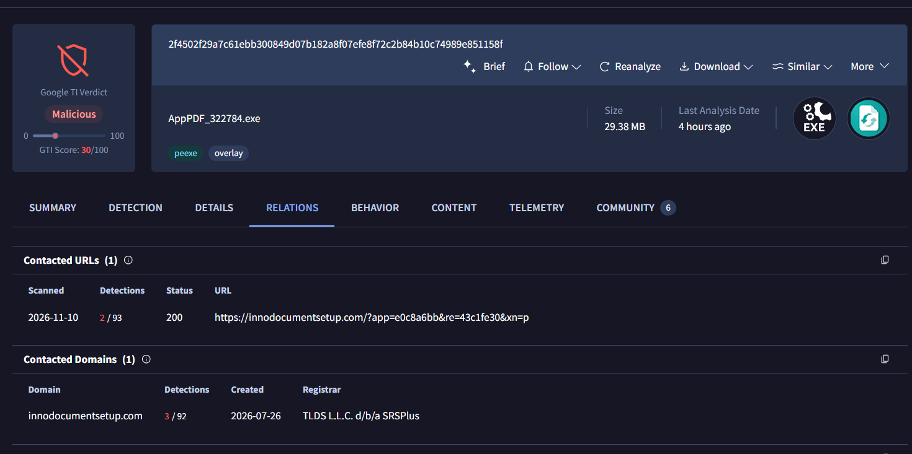
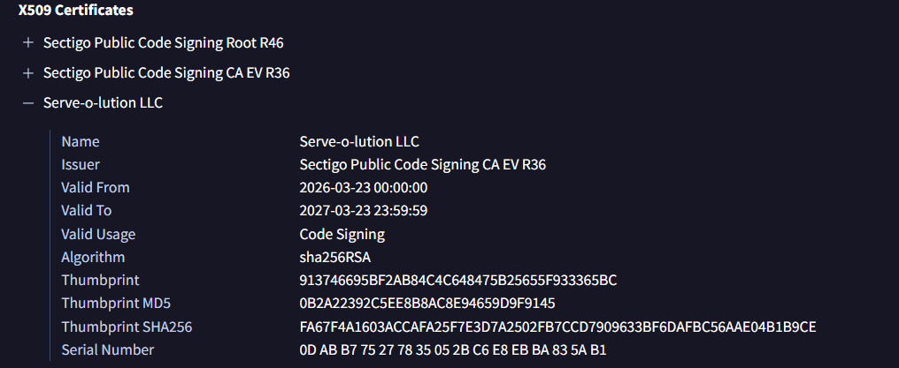
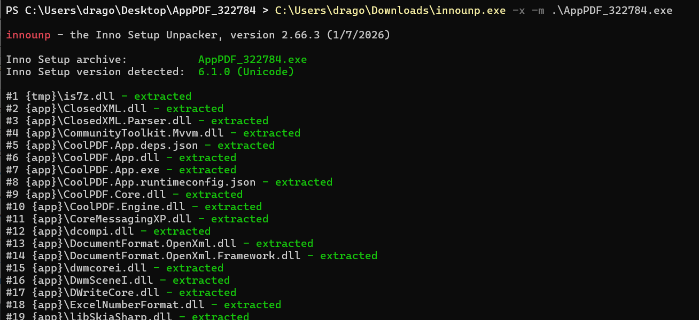
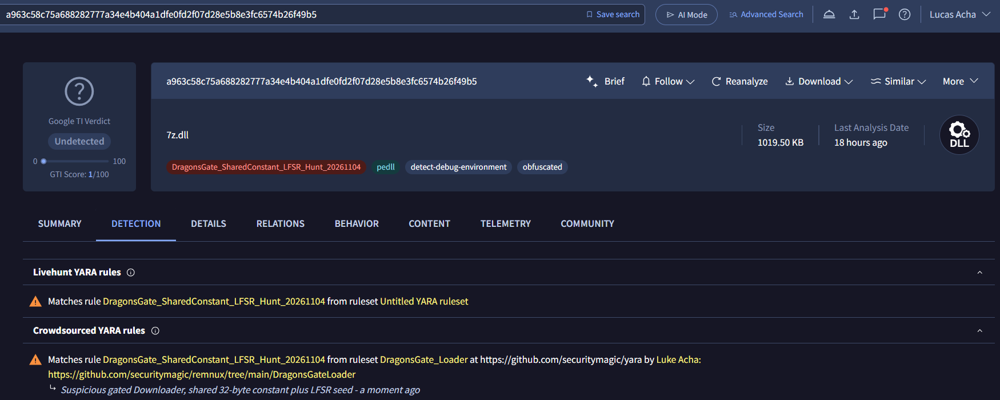
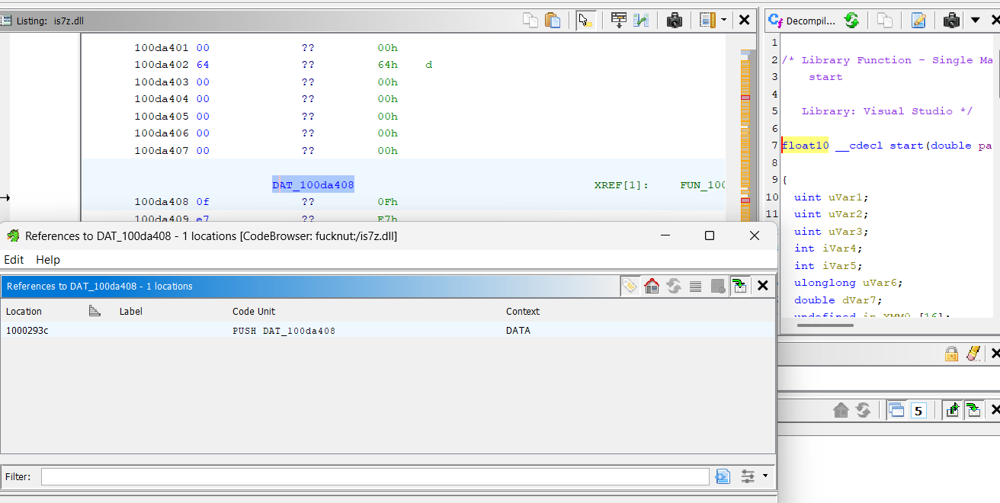
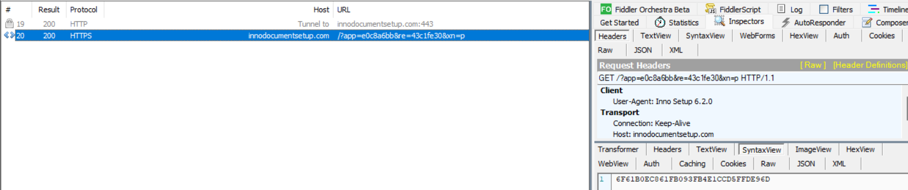
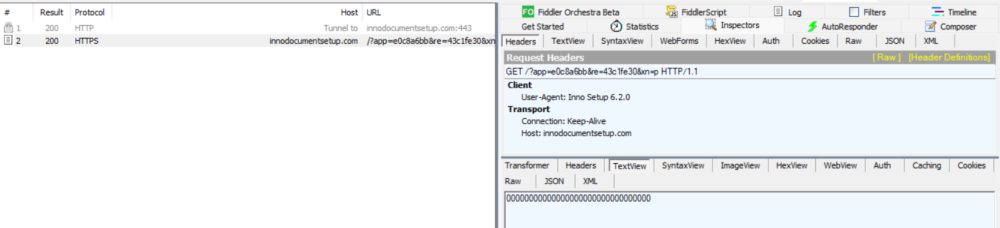
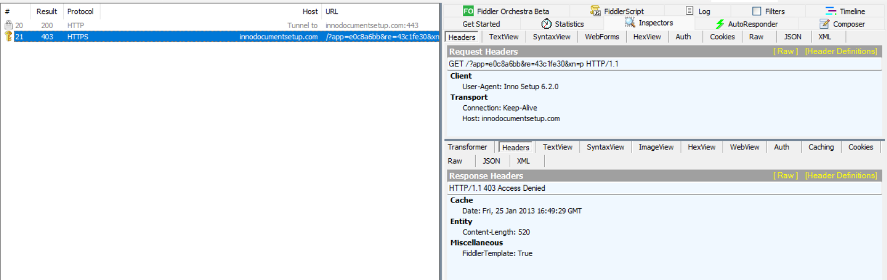
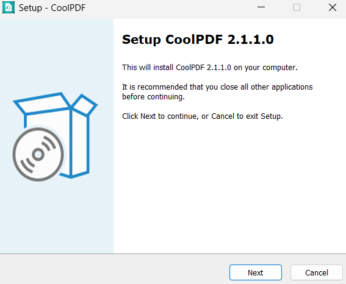

# DragonsGate: A Modified 7-Zip DLL Hiding an In-Memory PE Loader

**Technical malware analysis | November 12, 2026**  
**Scope:** CoolPDF / `AppPDF_322784.exe` — Inno Setup native loader investigation

> **Confidence and limitations:** The native DLL contains an LFSR-style transformation, shared DragonsGate constant, and manual PE mapping implementation. The instrumented run did **not** observe successful second-stage execution. The server response format and activation logic remain unconfirmed.

## 1. Executive summary

A signed PDF utility installer distributing **CoolPDF 2.1.1.0** contains a modified `is7z.dll` component that preserves expected 7-Zip exports while incorporating code for data transformation, command dispatch, and in-memory PE loading.

**Principal finding:** The extracted DLL matches a custom DragonsGate YARA hunt on a distinctive 32-byte constant and LFSR-seed indicator. Ghidra confirms executable code copies that exact constant, applies a bitwise LFSR-style transformation, and provides a manual mapper for 32-bit PE files. This is stronger than a static string match alone.

Static analysis also exposed XOR-obfuscated `LP|` and `RP|` command prefixes. The former invokes a file-loading routine with a custom four-byte length trailer; the latter leads to the staged processing routine containing the PE mapper. The installer was observed contacting `innodocumentsetup.com` before its welcome GUI. However, early-child Frida instrumentation did **not** observe the payload-loading or manual-mapping functions execute in the tested run.

**Scope / confidence:** High confidence that this DLL contains a DragonsGate-related loader implementation; **not** a confirmed successful infection chain or recovered second-stage payload. The relationship between the HTTP response and loader activation remains unproven.

## 2. Sample details and indicators

| Artifact / property | Observed value |
| --- | --- |
| Installer filename | `AppPDF_322784.exe` |
| Installer SHA-256 | `2f4502f29a7c61ebb300849d07b182a8f07efe8f72c2b84b10c74989e851158f` |
| Installer size | 29.38 MB (VirusTotal UI) |
| Installer archive format | Inno Setup 6.1.0 (Unicode), as identified by `innounp`; HTTP User-Agent reports `Inno Setup 6.2.0` |
| Installed application / GUI | CoolPDF 2.1.1.0 |
| Code-signing subject | Serve-o-lution LLC |
| Certificate issuer | Sectigo Public Code Signing CA EV R36 |
| Certificate SHA-1 thumbprint | `913746695BF2AB84C4C648475B25655F933365BC` |
| Certificate serial | `0D AB B7 75 27 78 35 05 2B C6 E8 EB BA 83 5A B1` |
| Extracted native DLL | `{tmp}\is7z.dll`; displayed as `7z.dll` in VirusTotal |
| DLL SHA-256 | `a963c58c75a688282777a34e4b404a1dfe0fd2f07d28e5b8e3fc6574b26f49b5` |
| Contacted host | `innodocumentsetup.com` |
| Observed GET URL | `https://innodocumentsetup.com/?app=e0c8a6bb&re=43c1fe30&xn=p` |
| Original HTTP response body | `6F61B0EC861FB093FB4E1CCD5FFDE96D` (32 ASCII hex characters) |



\*Figure 1. Fig. 1 — Installer's network relationship as displayed in VirusTotal.\*



\*Figure 2. Fig. 2 — Code-signing certificate details supplied with the sample.\*

Hashes, certificate fields and network indicators are from the screenshots and analysis session. Domain and URL are investigative indicators, not proof that every request to the infrastructure is malicious. No certificate-chain validation was performed independently in this report.

## 3. Installer unpacking and suspicious native DLL

`innounp` extracted the Inno Setup archive. The package contained ordinary-looking CoolPDF .NET application components such as `CoolPDF.App.exe`, `CoolPDF.App.dll`, `CoolPDF.Core.dll`, and `CoolPDF.Engine.dll`, alongside a temporary native `is7z.dll`.



\*Figure 3. Fig. 3 — innounp extraction shows {tmp}\is7z.dll beside the application payload.\*

The DLL retains 15 conventional-looking 7-Zip archive and codec exports, including `CreateObject`, `CreateDecoder`, `CreateEncoder`, `GetHandlerProperty`, `GetNumberOfFormats` and `SetCodecs`. No suspicious `cx1`/`cx2`/`cx3` exports were present in the observed export table. The malicious-capable functionality is instead reached through internal functions.



\*Figure 4. Fig. 4 — Custom DragonsGate YARA match on the extracted DLL. The screenshot shows Google TI as undetected; this is not a claim that every antivirus engine was negative.\*

The user's `DragonsGate_SharedConstant_LFSR_Hunt_20261104` rule matched the extracted DLL. YARA disclosed the exact static locations below:

| Pattern | File offset | RVA / section |
| --- | --- | --- |
| 32-byte shared constant | `0xD9408` | `0xDA408`, `.rdata` |
| Four-byte seed pattern | `0x1A1B` | `0x261B`, `.text` |
| Four-byte seed pattern | `0xDFB9D` | `0xE0B9D`, `.rdata` |
| Four-byte seed pattern | `0xEAEFD` | `0xEBEFD`, `.rdata` |
| Four-byte seed pattern | `0xF0261` | `0xF1261`, `.rdata` |

```text
0F E7 E7 1C A4 52 75 33 49 8D A9 D3 D9 9D 0E 43
7C 7D 25 79 74 20 E0 7D FB F5 06 AA 53 CF C3 6D
```

The short `00 00 00 95` seed pattern is weak in isolation. Its combination with the unusual 32-byte constant, and the later code references, is the substantive detection signal.

## 4. Reverse engineering: transformation and PE mapping

### 4.1 Shared constant used by executable code

Ghidra image base was `0x10000000`, placing the 32-byte constant at `0x100DA408`. A cross-reference at `0x1000293C` points to it. The surrounding decompiled function, `FUN_10002893`, copies 32 bytes from a global buffer, transforms that data, copies the shared constant immediately after it, then transforms the resulting 64-byte region.

```text
memcpy(work, global_buffer, 0x20);
FUN_10002606(work, 0x20);
memcpy(work + 0x20, &DAT_100da408, 0x20);
FUN_10002606(work, 0x40);
```

The code above is condensed pseudocode; it retains the observed operation order. The transformation routine initializes its internal state for each invocation, so the second call restarts the sequence across the full 64-byte buffer.



\*Figure 5. Fig. 5 — Direct code reference to the distinctive constant from the loader routine.\*

### 4.2 LFSR-style bitwise transformation

The implementation in `FUN_10002606` iterates over `length × 8` bits, initializes a 32-bit state to `0x95000000`, shifts that state right, conditionally inserts a high bit, and mutates buffer bits in place. This is consistent with an LFSR-style stream transformation; the full tap/feedback behavior was not independently reimplemented or test-vector verified here.

```text
state = 0x95000000;
for each input bit:
    feedback = compute_from_state(state);  // Ghidra loop
    state = (state >> 1) | (feedback ? 0x80000000 : 0);
    update_one_bit_of_buffer();
```

### 4.3 Custom trailer and file-to-buffer initialization

`FUN_10002e1a` checks that the last four bytes of an input buffer, interpreted as a little-endian integer, equal `buffer_length - 4`. This is a length-consistency marker, *not* cryptographic authentication. `FUN_10002cfb` reads a supplied path through `CreateFileW` / `ReadFile` and applies this check. On success, `FUN_10002751` copies the bytes to heap storage and updates global pointer `DAT_10118C5C` and size `DAT_10118C60`.

```text
// FUN_10002e1a — simplified
if (buffer != NULL && size > 4 &&
    read_le32(buffer + size - 4) + 4 == size)
    return true;
```

### 4.4 Manual in-memory PE loader

`FUN_100023ba`, reached via wrapper `FUN_1000238e`, checks DOS and NT headers (`MZ`/`PE`), restricts machine type to `0x14C` (x86), computes an image allocation, copies PE headers and sections, calls helper routines consistent with relocation/import processing, and transfers control to a mapped DLL entry point. It also retains the calculated entry-point pointer when not invoking a DLL entry point.

```text
// High-level actions in FUN_100023ba
validate_MZ_PE_and_x86_headers();
allocate_image_memory();
copy_headers_and_sections();
apply_relocations_if_needed();
process_imports_and_protections();
if (mapped_image_is_dll)
    DllMain(image_base, DLL_PROCESS_ATTACH, NULL);
```

This supports **manual PE mapping capability**. Helper labels for relocations, import handling, and protection are inferred from call order and PE-header access; those helpers were not all independently audited. `FUN_10002893` contains repeated mapping, export-resolution and indirect-call patterns consistent with staged processing.

Input file / bufferSource provided by caller

→

Trailer validationFUN\_10002e1a

→

Buffer initializationFUN\_10002751

→

LFSR + shared constantFUN\_10002606 / 10002893

→

PE mappingFUN\_100023ba

This diagram illustrates the identified code path, not a fully observed execution trace.

## 5. Hidden command interface

The internal dispatcher `FUN_100049EE` calls decoding helpers to recover command prefixes. `FUN_10004DCE` uses a per-character UTF-16 XOR transformation: `decoded[i] = encoded[i] XOR (0xA7 + i)`, for three characters.

| Encoded UTF-16 bytes | Decoded prefix | Observed code path |
| --- | --- | --- |
| `EB 00 F8 00 D5 00` | `LP|` | Passes trailing string to `FUN_10002CFB` for file read and validation |
| `F5 00 F8 00 D5 00` | `RP|` | Calls `FUN_10002893` with trailing string and another derived argument |

The dispatcher is called by both `FUN_10004968` and `FUN_10004F6F`, and another handler, `FUN_100030AA`, can process inputs not recognized by the first. Its small wrapper `FUN_10003066` uses the same string-XOR method. The specific decoded prefix in that secondary branch was not recovered from bytes in this session.

A worker-thread helper, `FUN_1000163B`, executes callbacks while pumping GUI messages and updating an `msctls_progress32` control. This is a normal UI pattern by itself and does not establish an IPC-based activation route.

**Command-interface limitation:** `LP|` and `RP|` are internal UTF-16 input prefixes. They are *not* established installer command-line arguments, HTTP response strings or network commands.

## 6. Pre-GUI dynamic analysis and network tests

### 6.1 Network request and response

Fiddler captured an HTTPS GET to `innodocumentsetup.com`, with query parameters `app=e0c8a6bb`, `re=43c1fe30` and `xn=p`, and a User-Agent of `Inno Setup 6.2.0`. The original HTTP 200 response body was 32 printable hex characters. Its semantics remain unknown.



\*Figure 6. Fig. 6 — Captured installer request and original hexadecimal response body.\*

### Protocol differences from previously analyzed DragonsGate variants

The observed request structure in this Inno Setup / 7-Zip implementation (`?app=e0c8a6bb&re=43c1fe30&xn=p`) differs from the earlier `init=prep` and randomized-parameter requests investigated in other DragonsGate builds. The server returned a 32-character hexadecimal string, but its purpose has not been determined. In particular, **there is no evidence that the earlier parity-based validation or response model applies to this variant**. Shared LFSR and PE-loading code does not establish a shared HTTP activation protocol. The `LP|` and `RP|` prefixes are *internal DLL commands*, not observed HTTP response instructions.

### 6.2 Controlled response comparison

| Test | Returned response | Observed GUI result |
| --- | --- | --- |
| Baseline | `200 OK`, original 32-character hex string | CoolPDF setup GUI opened |
| Modified body | `200 OK`, 32 zero characters | No visible difference |
| Denied | `403 Access Denied` (Fiddler AutoResponder template) | Setup GUI still opened |



\*Figure 7. Fig. 7 — AutoResponder with all-zero token body.\*



\*Figure 8. Fig. 8 — AutoResponder HTTP 403 Access Denied test.\*

The experiments establish that successful receipt of this specific body is **not required to display the visible setup GUI**. They do not demonstrate whether a valid response is required for hidden payload activation. No new Fiddler traffic was observed while finishing the installation in the reported instrumented run.

### 6.3 Early-child Frida instrumentation

Attaching Frida to the initial executable did not work because Inno Setup transfers execution to a child `AppPDF_322784.tmp` in an `is-*.tmp` directory. Late attachment to the child located and hooked `is7z.dll`, but missed earlier execution. A Windows process-creation interception approach subsequently suspended the child before execution, installed Frida hooks and resumed its primary thread.

```text
[09:55:06.207] Parent intercepted AppPDF_322784.tmp creation
[09:55:06.223] Attaching to suspended child PID=3460
[09:55:06.257] Child hooks installed; resuming thread
[DG] Loaded is7z.dll base=0x729a0000
[DG] Hooked dispatcher RVA=0x49ee
[DG] Hooked load_file RVA=0x2cfb
[DG] Hooked save_buffer RVA=0x2751
[DG] Hooked process_payload RVA=0x2893
[DG] Hooked manual_map RVA=0x23ba
```

The console showed the following dispatcher inputs, including one additional occurrence during continuation through the installation:

```text
[DG] dispatcher #1 input="CK|2.1.1.0|0"  → returned 0
[DG] dispatcher #2 input="CoolPDF.App.exe" → returned 0
[DG] dispatcher #3 input="CoolPDF.App.exe" → returned 0
[DG] dispatcher #4 input="CoolPDF.App.exe" → returned 0
```

`CK|2.1.1.0|0` is an **observed input**; its exact downstream handler and purpose were not conclusively established. Returning zero from `FUN_100049EE` indicates that particular handler did not report handling the input, not necessarily that the installer discarded it.

| Hooked routine | Observed hits | Interpretation |
| --- | --- | --- |
| Dispatcher, `0x49EE` | 4 | Command-processing function executed |
| File load, `0x2CFB` | 0 | File-based payload-loading path not observed |
| Buffer store, `0x2751` | 0 | Input-buffer initialization path not observed |
| Stage processing, `0x2893` | 0 | LFSR/manual-mapping caller not observed |
| Manual PE mapper, `0x23BA` | 0 | Manual mapping not observed |



\*Figure 9. Fig. 9 — CoolPDF 2.1.1.0 GUI, displayed despite the controlled HTTP response changes.\*

The saved Python launcher log contains process-interception events, but not the `[DG]` JavaScript trace lines. The function-hit observations above are transcribed from the session's console output supplied during analysis. Counts apply to the instrumented session, not every possible execution path.

## 7. Detection and hunting opportunities

Defenders can hunt this implementation using a layered approach, prioritizing the precise static constant and supporting code or behavioral context over broad PDF-software indicators.

| Signal | Practical use / caveat |
| --- | --- |
| Exact 32-byte constant | High-value static family pivot, especially if combined with decoder seed or PE-mapping code |
| `0x95000000` / seed bytes | Supporting indicator only; four-byte matches are not specific enough alone |
| Unusual `is7z.dll` | Compare DLL hashes and code sections to trusted 7-Zip/Inno components, not filename alone |
| Hidden `LP|`, `RP|` prefixes | Potential decoded-string or memory-hunt pivots; not established network IOCs |
| Manual PE mapping operations | Correlate PE-header validation, memory allocation, relocation/import processing and indirect execution |
| Inno temporary child | Observe `AppPDF_322784.tmp` loading a modified DLL early in process life; generic temp Inno processes are normal |
| Domain, installer and DLL hashes | Exact-match IOCs for retrospective hunting; use domain context and timestamps |

#### Illustrative YARA hunting snippet (not a replacement for validated rule)

```text
rule DragonsGate_7z_SharedConstant_Research {
    meta:
        description = "Research pivot: shared DragonsGate 32-byte constant"
        confidence = "Requires corroboration"
    strings:
        $constant = { 0F E7 E7 1C A4 52 75 33 49 8D A9 D3 D9 9D 0E 43
                      7C 7D 25 79 74 20 E0 7D FB F5 06 AA 53 CF C3 6D }
    condition:
        uint16(0) == 0x5A4D and $constant
}
```

This is a simple IOC-oriented example, not the user's tested `DragonsGate_SharedConstant_LFSR_Hunt_20261104` rule. It has not been false-positive tested.

### Function / address reference

| Ghidra VA (base 0x10000000) | Role |
| --- | --- |
| `0x100049EE` | Hidden command dispatcher |
| `0x10002CFB` | Read and validate supplied file |
| `0x10002751` | Copy validated buffer to globals |
| `0x10002893` | Transformed buffer and staged processing |
| `0x10002606` | LFSR-style transformation |
| `0x1000238E` | Wrapper around manual mapper |
| `0x100023BA` | Manual x86 PE mapping |
| `0x100030AA` | Secondary string handler |
| `0x100DA408` | Shared constant data, not executable function |

## 8. Conclusions and unresolved questions

The CoolPDF installer includes a native 7-Zip-compatible DLL that carries a distinctively DragonsGate-related data transformation and a genuine manual PE-mapping implementation. The shared 32-byte constant is referenced by executable code, and XOR-obfuscated internal commands provide paths to load and process staged data. The installer also establishes a pre-GUI network connection with `innodocumentsetup.com`.

In controlled tests, the visible GUI appeared regardless of whether the endpoint returned its original hexadecimal response, an all-zero value or HTTP 403. A Frida trace attached to the Inno child from process startup recorded dispatcher calls but not the file-reading, buffer-initialization, stage-processing or manual-PE-mapping functions.

**Final assessment:** Confirmed native manual-PE-loader functionality and shared DragonsGate decoding indicators within `is7z.dll`. Observed command dispatcher activity and pre-GUI HTTP communication. Not observed successful payload activation, second-stage recovery, or a verified server response format that unlocks the loader.

Future analysis would be best served by correlating the network response with its actual consumer, or by obtaining a sample/run that reaches the `LP|` and `RP|` paths. Further reverse engineering of generic UI callbacks is unlikely to materially change these findings.

Prepared from reverse-engineering excerpts, screenshots and FLARE-VM dynamic-analysis observations supplied in the investigation session, 12 November 2026. This report documents behavior observed or code identified in a suspicious installer; it does not contain or redistribute malware binaries.
