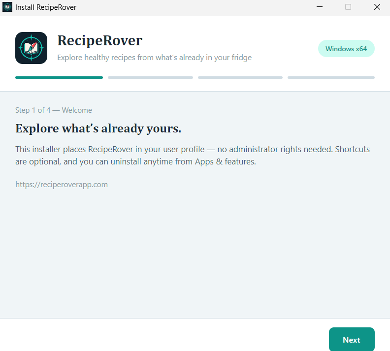
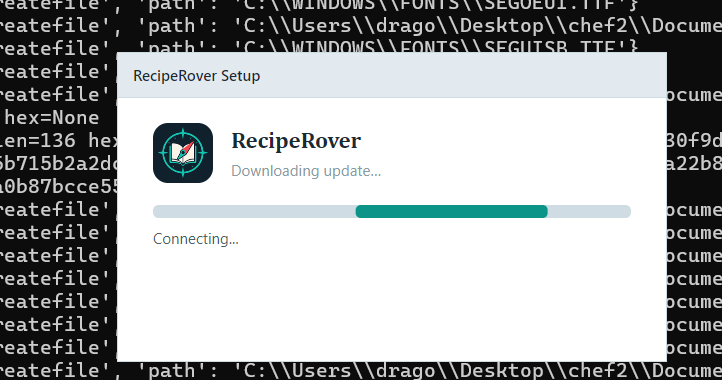
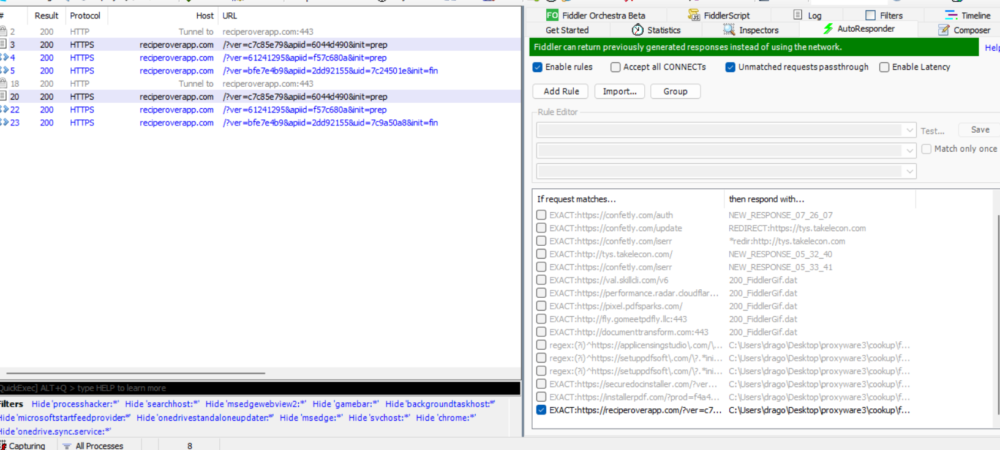
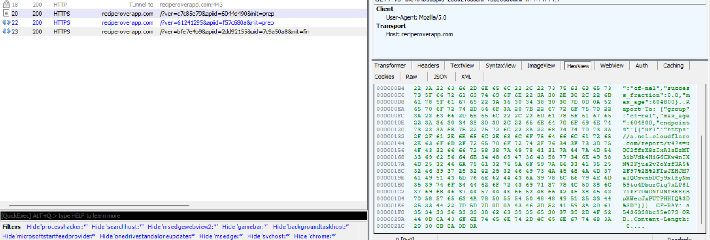

# RecipeRover Setup: Filename- and Response-Gated Staged Downloader

**Analysis date:** 1–2 November 2026  
**Environment:** Windows 11 FLARE-VM; Fiddler, Frida, Malcat, Ghidra, Process Hacker, dnSpy, de4dot  
**Status:** **Gated downloader confirmed by static and dynamic analysis; subsequent native payload not recovered**

> **Scope and caution:** These findings concern the **RecipeRover setup executable**, not proof that the installed recipe-management application (`RecipeRover.dll`) itself is malicious. All experiments were performed in a malware-analysis VM. The final download endpoint returned an empty response in observed runs; no delivered second-stage payload was recovered or executed.

## Executive summary

The RecipeRover installer (`cook4.exe`) contains a separate, obfuscated .NET 8 setup assembly. Normal execution under the analyst-assigned filename `cook4.exe` contacted `reciperoverapp.com` but proceeded to the ordinary installation path. Reverse engineering disclosed two requirements for the alternative path: (1) a patterned executable filename ending with `-` or `_` and **3–8 ASCII alphanumeric characters**, and (2) an initial server response whose **ASCII decimal digits sum to an even number**. Renaming the same binary to `Document_123456.exe` and substituting a known even-parity first response in Fiddler activated a visibly different **“Downloading update...”** interface and caused two additional network requests, including `init=fin`.

The setup assembly also includes process/service environment inspection, a staged downloader, custom payload validation/transformation, and a native in-memory PE loader. However, the last observed server response was empty (`Content-Length: 0`). **Potential capability must not be confused with successfully observed payload execution.**

### Comparing the two installer paths

**Baseline — gated path not activated:** Running the analyst-named `cook4.exe` shows the ordinary, four-step **“Install RecipeRover”** wizard (Step 1 of 4 — Welcome). This is the screen observed when the filename condition is not satisfied; the original odd-parity server response also fails the initial token check.



*Figure 1. Normal installation path: the “Explore what's already yours” welcome screen.*

**Alternative — gated path activated:** Renaming the identical installer binary to `Document_123456.exe` and substituting an even-parity first `init=prep` response produced a different **“RecipeRover Setup”** window with **“Downloading update...”** and **“Connecting...”** progress indicators.



*Figure 2. Gated staged-download path: the alternate “Downloading update...” interface. This screen does not by itself prove a payload download succeeded.*

## Sample identifiers

| Artifact | Value | Notes |
|---|---|---|
| Original installer | `cook4.exe` | Analyst-assigned filename |
| SHA-256 (original installer) | `e1d8cea8f23a4c2ccfa104e367eee028c16484db9fb635c17ed05761ede1e0be` | 34,860,504 bytes |
| Renamed test file | `Document_123456.exe` | Same original executable content, renamed to satisfy filename condition |
| Embedded setup assembly | `RecipeRover.Setup.dll` | Carved from the **original installer**, not the installed application |
| SHA-256 (carved DLL) | `2a22c1561e3a662e68d47823a49e8fae8f9dfc375a8f5e2271dbb901b3f9b3ef` | 1,948,672 bytes |
| Carve file offset | `0x184B000` | Offset in original `cook4.exe` |
| Embedded setup metadata | `RecipeRover Setup`, version `1.2.0.0` | Managed .NET 8/Avalonia installer component |
| Installed application | `RecipeRover.dll` | Separate recipe application; not the primary target here |
| Network domain | `reciperoverapp.com` | Live setup traffic observed; do not assume every domain request is malicious |

The DLL hash refers to the **pre-de4dot carved assembly**. A de4dot-processed DLL will normally have a different hash.

## Investigation chronology

### 1. Initial installer behavior

Running `cook4.exe` produced an ordinary RecipeRover installation. Fiddler captured an HTTPS GET to the setup domain, including:

```http
GET /?ver=c7c85e79&apiid=6044d490&init=prep HTTP/1.1
Host: reciperoverapp.com
User-Agent: Mozilla/5.0
```

One observed 32-character response was `05C9056049C819B2400DF72234D890BB`. Its ASCII decimal digits sum to **97** (odd). The ordinary installation continued; no subsequent `init=fin` request was observed in this baseline. Earlier attempts replacing the response with an even-sum token while still using the filename `cook4.exe` did not activate the update path.

### 2. Malcat and Ghidra triage

Malcat flagged `BlacklistSandbox`, `FingerprintHardware`, `FingerprintEnvironment`, and network-related heuristics. Its `BlacklistSandbox` rule requires matches on two common sandbox-related strings, and **does not by itself prove active anti-analysis**. Subsequent decompiled code provided stronger evidence for process/service inspection.

Searching Ghidra's program text for `init=prep` failed. Byte-level inspection of the installer found `reciperoverapp.com` in the binary, but the two observed plaintext occurrences were in .NET assembly/version metadata, not a plain request template. Protected strings in the setup assembly explain why a direct text search was insufficient.

### 3. Recovering the **setup** assembly

Process Hacker showed Avalonia-related strings, and `%TEMP%\.net\cook4\...` held extracted **native** dependencies such as `av_libglesv2.dll`, `libHarfBuzzSharp.dll`, and `libSkiaSharp.dll`, but not `RecipeRover.Setup.dll`. This is compatible with managed code loaded from a single-file bundle without being extracted as a standalone file.

The installed `RecipeRover.dll` was inspected separately and contained recipe-management functionality. It was **not** substituted for the setup executable when investigating the gate.

The initially installed `sfextract` 2.1.0 rejected the installer. After installing the .NET 8 SDK and upgrading to `sfextract` 2.3.0, the tool still reported:

```text
Is not a .NET Core 3.x or greater executable.
```

This was an extractor compatibility/recognition failure, **not evidence the assembly did not exist**. Direct PE inspection located an embedded `RecipeRover.Setup.dll` at file offset `0x184B000`, and a 1,948,672-byte managed PE was carved from the original installer. It was then processed with **de4dot** and exported/decompiled with **dnSpy**. These steps exposed the relevant installer control flow.

For reproducibility, the following one-line PowerShell command carves this **specific sample** (not a generic bundle extraction method):

```powershell
py -c "from pathlib import Path; b=Path('cook4.exe').read_bytes(); o=0x184B000; n=1948672; Path('RecipeRover.Setup.carved.dll').write_bytes(b[o:o+n]); print('Carved',n,'bytes')"
```

Verify the carved DLL hash against the table before analysis; arbitrary changes to the source installer invalidate these fixed offsets.

### 4. Decompiled filename gate

The deobfuscated export points to `ns26/Class16.cs`:

- `smethod_2()` obtains the current executable name and delegates to `smethod_9()`.
- `smethod_9()` removes the `.exe` suffix, strips qualifying trailing ` (digit)` copy-name suffixes, and examines the remaining name.
- The name must end in `-` or `_` followed by **3–8 ASCII alphanumeric bytes**. Other filenames fail the gate.

Examples:

| Filename | Expected result |
|---|---|
| `cook4.exe` | Reject |
| `RecipeRover.exe` | Reject |
| `Document_123456.exe` | Accept |
| `RecipeRover-a92.exe` | Accept |
| `RecipeRover_6044d490.exe` | Accept |

The naming pattern may correspond to distributed/campaign-specific binaries. This is a hypothesis about purpose, not a verified attribution or distribution mechanism.

### 5. Decompiled initial response gate

`ns17/Class8.cs` (`smethod_0()`) downloads the first preparation response and calls `Class16.smethod_7(...)`. That method checks the filename predicate and then sums **ASCII decimal digits** from the response string. An **odd sum rejects** the gated path; an **even sum permits** it, provided the filename predicate passes.

Simplified logic (analyst pseudocode, not a verbatim source excerpt):

```csharp
if (!FilenameMatchesExpectedPattern()) return Reject;
int digitSum = response.Where(char.IsAsciiDigit).Sum(c => c - '0');
if ((digitSum % 2) != 0) return Reject;
return Accept;
```

Observed responses:

| Context | Token | Decimal digit sum | Parity |
|---|---|---:|---|
| Initial live response | `05C9056049C819B2400DF72234D890BB` | 97 | Odd |
| Fiddler substitute for first request | `DD8CCF3E63FD7D2B8CD9986124FF7D81` | 92 | Even |
| Live second preparation response | `F5CC4324E166D0AEE0DEE78C2A45E29D` | 68 | Even |

These tokens are **observed response examples, not durable IOC signatures**: they may vary by request or server configuration.

### 6. Controlled activation: renaming + AutoResponder

The analyst ran a copy of the same installer renamed **`Document_123456.exe`**, with Fiddler AutoResponder configured to return the 32-character even-parity fixture **for the initial preparation request only**. This time the installer displayed **“Downloading update...” / “Connecting...”** instead of the ordinary setup path, and Fiddler captured an expanded sequence:

```text
GET https://reciperoverapp.com/?ver=c7c85e79&apiid=6044d490&init=prep
GET https://reciperoverapp.com/?ver=61241295&apiid=f57c680a&init=prep
GET https://reciperoverapp.com/?ver=bfe7e4b9&apiid=2dd92155&uid=7c9a50a8&init=fin
```

*The parameter values above are from one captured run. The screenshot shows repeated attempts and differing `uid` values; do not hardcode those values as universal requirements.*



*Figure 3. Fiddler confirms the transition from initial preparation to the final-stage request after the gates were satisfied.*

**Independently observed effect:** Filename plus initial-token manipulation changed both the application UI and subsequent HTTP request sequence. This is stronger than inference from decompiled code alone.

### 7. Is the second `init=prep` another parity gate?

The server's second preparation response was `F5CC4324E166D0AEE0DEE78C2A45E29D` (sum **68**, even). To test an additional parity check, the analyst substituted an odd-parity fixture **only on the second** `init=prep`. There was **no observable difference**: the workflow still reached the final request.

This is consistent with the decompiled `Class8.smethod_1()` logic: it sends the second request, returns true if the operation succeeds, and **does not invoke the digit-parity validator**. It should therefore be described as a **second preparation/handshake stage**, not a proven second parity gate. The experiment assumes the second AutoResponder rule matched as intended.

### 8. `init=fin`: reached, but payload not supplied

The final request was visible in Fiddler and returned HTTP **200**, but the inspected response had **`Content-Length: 0`**. Cloudflare-related headers (`CF-RAY`, `cf-nel`) were present; these do **not** by themselves prove a CAPTCHA or Cloudflare block.



*Figure 4. The final-stage response did not deliver an observable payload.*

The supplied Frida log (`rust-traffic-hook-clientdll.py` monitoring `Document_123456.exe`) recorded a CONNECT to `reciperoverapp.com:443` and encrypted TLS records. It did not capture decrypted HTTPS payload content or confirm native payload execution. No additional malicious payload was recovered from this experiment.

## Static capabilities found in the setup assembly

| Component | Decompiled behavior | Interpretation |
|---|---|---|
| `ns26/Class16.cs` | Filename gate, first-response digit-sum test | Staged activation conditions |
| `ns26/Class16.cs` | Enumerates processes and Windows services; hashes names before comparison | Environment-analysis/anti-analysis capability; specific matched tools not fully resolved |
| `ns17/Class8.cs` | Multiple HTTP requests and response processing | Preparation and payload-download plumbing |
| `ns32/Class22.cs` | Checks second request success; downloads bytes; validates buffer before further processing | Loader workflow |
| `Class28` / `Class29` | Custom transformation and payload-format validation | Nonstandard packaging; exact payload unknown |
| `Class25` / `Class17` / `Class18` / `Class19` | Processes native buffer and maps/calls native code, including PE mapping operations | In-memory native loader capability |
| `Class35.smethod_24()` | Protected-string decoding | Obscures plaintext URL templates and other strings |

`Class19`'s manual PE loader functionality includes allocation, copying image data, relocation/import handling, and memory protection adjustments. These code paths are **statically identified**, not demonstrated to have run successfully in this capture.

## Indicators and hunting pivots

| Type | Indicator | Significance / caution |
|---|---|---|
| SHA-256 | `e1d8cea8f23a4c2ccfa104e367eee028c16484db9fb635c17ed05761ede1e0be` | Original `cook4.exe` sample; remains the same if renamed without altering bytes |
| SHA-256 | `2a22c1561e3a662e68d47823a49e8fae8f9dfc375a8f5e2271dbb901b3f9b3ef` | Embedded setup DLL carved **before** de4dot |
| Domain | `reciperoverapp.com` | Network infrastructure contacted by this installer |
| URL pattern | `https://reciperoverapp.com/?ver=*&apiid=*&init=prep` | Initial and second preparation requests; query ordering may vary |
| URL pattern | `https://reciperoverapp.com/?ver=*&apiid=*&uid=*&init=fin` | Observed final-stage request |
| Filename behavior | `*-<3–8 ASCII alnum>.exe` or `*_<3–8 ASCII alnum>.exe` | Activation heuristic, **not** a standalone malicious IOC |
| Response behavior | 32-character token with even sum of ASCII decimal digits | First response gate; 32-character length is observed, not the sole condition proven by the shown method |
| Installed path | `%LOCALAPPDATA%\Programs\RecipeRover\` | Ordinary application artifact, not independently malicious |

### Example investigation queries

```text
Host telemetry:
  Process execution of RecipeRover setup binary, especially renamed copies matching *_XXXX.exe or *-XXXX.exe.
Network telemetry:
  Requests to reciperoverapp.com containing init=prep or init=fin.
Correlate:
  Same host/process sends init=prep twice, then init=fin; inspect the final response size and any subsequent memory-execution telemetry.
```

Do not alert on filename pattern alone: it is intentionally broad and will have substantial benign overlap.

## Relationship to CookUp / GooPDF

This sample strengthens the **technical resemblance** to previously investigated CookUp/GooPDF installers: obfuscated setup code, `init=prep`-style traffic, server-dependent progression, and staged native code execution capability. The independent filename-pattern condition and parity validation provide especially useful comparative traits. However, this report does **not** by itself prove the installers share an identical binary loader, operator, or delivered malicious payload. Confirm such attribution with direct code/decoder/payload comparison.

## Conclusions and limitations

**Confirmed:** the original installer embeds an obfuscated managed setup assembly; its executable filename and first preparation response control an alternate staged-download workflow. The alternate workflow was dynamically activated in the lab, and it issued a second `init=prep` plus an `init=fin` request. Decompiled code contains native in-memory execution functionality.

**Not confirmed:** receipt of a second-stage binary, actual execution of that stage, its capabilities, operator identity, and the reason the live `init=fin` response was empty. An HTTP 200/empty body is not evidence of successful payload delivery.

### Suggested next work

1. Compare deobfuscated setup methods and protected-string decoders directly with the CookUp/GooPDF setup samples.
2. Resolve process/service hash constants to enumerate anti-analysis targets.
3. Inspect any legitimately obtained non-empty final response **offline**, without assuming it is safe to execute.
4. Hunt for the `init=prep` → `init=prep` → `init=fin` sequence and suspicious renamed installer binaries in telemetry.

---

*All screenshots included in this package are from the analyst's Fiddler/FLARE-VM investigation. No additional executable malware samples are bundled with this report.*
